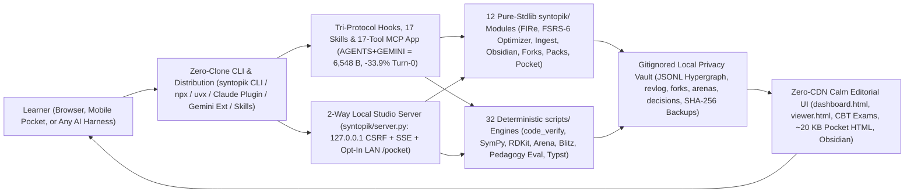

# Syntopik

**Local-first AI Deep-Mastery OS — probe your frontier, verify derivations & code deterministically, and compound FSRS-6 + FIRe understanding across any AI harness or browser.**

[](https://github.com/HridayKapoor/syntopik/actions/workflows/ci.yml)
[](./CHANGELOG.md)
[](./LICENSE)
[](#quick-start)
[](#quick-start)
[](#integrate-with-anything-in-10-seconds)

Syntopik turns the AI coding harness you already use (**Google Antigravity 2.0**, **Anthropic Claude Code**, **Cursor**, **Windsurf**, **VS Code / Copilot**, **OpenAI Codex / T3 Code**, **Gemini CLI**, **OpenCode**, or a **zero-clone browser workbench**) into a calm, rigorous, hands-free **Deep-Mastery Operating System** for **any domain**: Computer Science, Distributed Systems, Machine Learning, Mathematics, Physics, Chemistry, Research Papers, University Courses, and Competitive Exams (including full NTA JEE Main & Advanced CBT).

---

## Visual Showcase

Zero-CDN, calm editorial interfaces in **Warm Obsidian & Vellum Ink** (Dark) and **Archival Vellum & Graphite** (Light) — live two-way via `syntopik serve` and 100% functional offline via `file://`.

<p align="center">
  <picture>
    <source media="(prefers-color-scheme: dark)" srcset="./docs/assets/dashboard-dark.png">
    <source media="(prefers-color-scheme: light)" srcset="./docs/assets/dashboard-light.png">
    
  </picture>
</p>
<p align="center">
  <sub><strong>7-Tab Study Hub (<code>dashboard.html</code>)</strong> — adapts automatically to your GitHub theme (<a href="./docs/assets/dashboard-dark.png">Dark</a> · <a href="./docs/assets/dashboard-light.png">Light</a>). Live 2-way FIRe Flashcards &amp; SVG Occlusion, 365-day Retention Heatmap, Brier Calibration, Cognitive Energy mode, Autopilot, 13-category Mistake Analytics, Hypergraph, Mnemonic Markdown+LaTeX Reader, Labs &amp; Exams.</sub>
</p>

| Inline `Syntopik Studio` Cards (SEP-1865 MCP App) | Joint-Premise Knowledge Hypergraph (`viewer.html`) |
| :---: | :---: |
|  |  |
| Bare matched options, `"I don't know"` non-penalty button, `0–100%` confidence rail, thinking pad, keyboard-accessible Parsons/Faded block ordering, and server-sealed solutions. | Models true multi-premise `premises[] -> conclusion` (`∧`) reasoning chains with `encompassWeight`, True FIRe prerequisite credit, `boundaryConditions[]`, and in-inspector live FSRS ratings. |

---

## Integrate With Anything in 10 Seconds

Zero mandatory pip/npm dependencies for core CLI, Studio Server, CS verification, ingestion, Obsidian sync, and mastery drills.

| User / Harness | 10-Second Command | What Works Immediately |
| :--- | :--- | :--- |
| **Zero-Clone Browser Workbench** | `npx github:HridayKapoor/syntopik serve --open`<br>`uvx --from git+https://github.com/HridayKapoor/syntopik syntopik serve --open` | Auto-creates `~/.syntopik`, launches 2-way Studio (`http://127.0.0.1:4173`) with FIRe flashcards, SVG image occlusion, URL/PDF import, 365-day heatmap, and auto-graded CBT exams — zero git clone. |
| **Claude Code (Any Repo)** | `/plugin marketplace add HridayKapoor/syntopik`<br>`/plugin install syntopik` | All 17 `/syntopik:*` skills, 17-tool `syntopik-studio` MCP App (incl. ambient capture), and plugin-cache-safe `SessionStart` / `PostToolUse` hooks in any project. |
| **Cursor / Windsurf / Copilot / Codex / Cline / Roo / OpenCode** | `npx skills add HridayKapoor/syntopik`<br>`npx github:HridayKapoor/syntopik attach .` | Installs all 17 `agentskills.io` skills + thin pointer rule (`.cursor/rules/syntopik.mdc`, `.windsurf/rules/syntopik.md`, `.github/instructions/syntopik.instructions.md`) + native MCP config (`.vscode/mcp.json` `"servers"`, `opencode.json` `"mcp"`, `.cursor/mcp.json`) + `.git/info/exclude` with zero diff to host `AGENTS.md` or `.gitignore`. |
| **Google Antigravity 2.0 (Any Repo)** | `syntopik connect antigravity`<br>*(or `uvx --from git+https://github.com/HridayKapoor/syntopik syntopik connect antigravity`)* | Installs global `~/.gemini/config/plugins/syntopik/` bundle (`plugin.json`, 17 skills, rules, hooks, and SEP-1865 Studio MCP App) across every workspace. |
| **Gemini CLI (Any Repo)** | `gemini extensions install https://github.com/HridayKapoor/syntopik` | Installs `gemini-extension.json`, `GEMINI.md`, 17 skills, hooks, and `syntopik-studio` MCP server. |
| **Standalone Clone / Full STEM** | `git clone https://github.com/HridayKapoor/syntopik && cd syntopik && syntopik serve --open` | Full local SymPy/Pint, RDKit/ChemPy, Schemdraw, Typst, RapidOCR, Manim, and offline `file://` fallback. |

---

## Why Syntopik v2.0 Beats Prompt Tutors, BYOK Wrappers & Flashcard Pipelines

| Existing Approach | Where It Breaks | How **Syntopik v2.0** Solves It |
| :--- | :--- | :--- |
| **Prompt-Only Socratic Wrappers** *(ChatGPT Study Mode, custom prompts)* | 500-word walls of text, session amnesia, sycophantic praise, unverified math/code hallucinations, high Turn-0 prompt bloat. | **Calm Anti-Overstimulation OS** (`<= 160`w prose/turn, `1` active demand/turn, dry zero-sycophancy voice, `AGENTS.md + GEMINI.md = 6,548 B` — `-33.9%` Turn-0 load) + **TutorBench Linter** (`pedagogy_eval.py`) + **Persistent Hypergraph**. |
| **Standalone BYOK Wrappers & Paid Apps** *(Electron tutors, paywalled mobile decks)* | Separate app to maintain, extra API bills, no CAS/code/chemistry engines, flat decks, $25+ mobile paywalls that break offline. | **100% Harness-Native + Zero-Clone `syntopik serve`** + **12 Pure-Stdlib Core Modules & 32 Local Engines** + **Free ~20 KB Offline Pocket HTML5 Commute Deck** with opt-in LAN QR sync. |
| **RAG + Manual Flashcard Pipelines** *(NotebookLM → Chat → Anki)* | *Epistemic Drift* (unverified caveats encoded into SRS), flat cards with zero prerequisite credit, red-backlog burnout after missed weeks. | **Pre-Commit Deterministic Verification** + **True FIRe & Spaced Repetition Compression** + **Zero-PyTorch SciPy Personal FSRS-6 Optimizer** + **Calm Catch-Up & Re-Entry Briefs**. |

---

## What's Inside Syntopik v2.0

### 1. Memory, Calibration & Cognitive Science Engine (`syntopik/fsrs_core.py`, `scripts/srs_engine.py`)
- **True FIRe + Spaced Repetition Compression (Math Academy HSRS)**: Reviewing an advanced theorem or algorithm automatically propagates fractional implicit credit along `chains.jsonl` hyperedges (`encompassWeight` + depth decay `gamma`, discounted by `(1 - R)` on early reviews) while **never** auto-clearing `misconception` nodes. `due --compress` collapses redundant prerequisite reviews when higher-level items cover them.
- **Zero-PyTorch SciPy L-BFGS-B Personal FSRS-6 Optimizer**: Fits personal FSRS-6 parameters from `knowledge-graph/revlog.jsonl` using lightweight SciPy L-BFGS-B (pure-stdlib fallback when SciPy is absent) and accepts updated weights **only** when chronological out-of-sample Log-Loss improves.
- **Brier / ECE & Hypercorrection Calibration**: Tracks chance-calibrated `0–100%` confidence against outcomes in `revlog.jsonl`, surfacing Brier score, Expected Calibration Error, overconfidence bias, high-confidence misses (*hypercorrection* signals), and lucky guesses.
- **Calm Backlog Recovery, Forecasting, Leeches & Sibling Burying**: `recover --daily-cap 15` smoothly redistributes missed queues without guilt; `forecast --exam-date` projects exam-day retention; `leeches` flags chronic `lapses >= 4` or `difficulty >= 8.5` items; `--bury-siblings` spaces related cues by 24h.

### 2. 2-Way Live Local Studio Server (`syntopik serve`) — 100% Offline `file://` Fallback Intact
- **Zero-Dependency Local Workbench (`syntopik/server.py`)**: Pure Python 3.12 `ThreadingHTTPServer` bound strictly to `127.0.0.1` with per-process `X-Syntopik-Token` CSRF protection, strict canonical path jail, and live **SSE (`/api/events`)** file watchers so changes made by an AI agent in chat update the browser automatically.
- **Interactive Flashcards & Clickable SVG Image Occlusion**: Review due cards directly in `dashboard.html`, `knowledge-graph/viewer.html`, or the `synt_lesson_studio` side-pane with clickable SVG occlusion masks (`pdf_studio.py annotate --occlude`), confidence sliders, and quiet `FIRe refreshed N prerequisites` toasts.
- **365-Day Retention Heatmap & Interactive Autopilot**: Mineral-sage daily activity grid (`schemaVersion: 4`), rolling Brier readout, 1-click Calm Catch-Up, and directly clickable Autopilot topic chips and milestones.
- **Auto-Saved 3-Bucket Exam Autopsy**: Submitting an offline CBT exam (`demos/exam-cbt-template.html`) in live mode auto-grades deterministically (`POST /api/exam/submit`), credits solved `propId`s as `good`, logs misses + 3-strike escalations, and renders a **Knowledge / Execution / Time-Sink** autopsy with `Ego-Trap` tags — while keeping `Download Attempt JSON` working seamlessly over `file://`.

### 3. 1-Command Universal Ingestion (`syntopik import`) & Bidirectional Obsidian / Mnemonic Sync
- **Universal Source Importer (`syntopik/ingest.py`, `scripts/ingest_source.py`)**:
  - **YouTube**: Caption-only transcript extraction with 5–8 minute chapters, `[mm:ss]` jump links, and Active Pause-Point checks (`lecture.md`).
  - **arXiv**: Atom metadata + structured **Keshav 3-Pass** reading guide (`keshav-3-pass.md`).
  - **GitHub / Local Repos**: Architecture & **Golden-Path Repo Map** (`repo-map.md`) within token budgets.
  - **Web URLs & Incremental Reading Queue**: Strict `http://`/`https://` HTML-to-Markdown slicing into `knowledge-graph/reading-queue.jsonl` (`queued -> extracted -> clozed -> crystallized`).
  - **PDFs & Lecture Notes**: Teacher-First canonical spine locking (`p.1 -> p.N`), RapidOCR / `pdfplumber` tables, and white-halo + SVG occlusion crops.
- **Bidirectional Obsidian & Matuschak Mnemonic Medium Sync (`syntopik/obsidian.py`, `scripts/vault_sync.py`)**:
  - Exports clean Markdown notes with minimal YAML (`syntopik_id`, `status`, `mastery` — zero noisy FSRS clutter), `[[wikilinks]]` from `chains.jsonl`, and `Trap-MOC.md` from `mistakes.jsonl`, updating strictly inside `<!-- syntopik:begin -->`…`<!-- syntopik:end -->` so personal notes are never touched.
  - Parses inline `:::cue` blocks (`recall` / `application` / `procedural` / `salience`), `{{c1::...}}` clozes, and `Q:: / A::` pairs directly from `chapters/*.md` or an Obsidian vault without losing FSRS history, and renders them as collapsible 6-second review strips in the Chapter Reader Drawer.

### 4. Out-of-the-Box Mastery Modes & Deterministic Verification
- **BKT-Gated Adaptive Faded Parsons (`synt_practice_card`)**: Automatically scales scaffolding by BKT mastery (`parsons` drag/keyboard block ordering with distractors → `faded` inline `___` blanks → `standard` blank-slate writing) with server-sealed `canonicalOrder` and `modelSolution`.
- **Protégé Teach-Back & Surgical Bug-Hunt**: 3-turn Feynman Teach-Back capstone (where the tutor plays a sharp novice asking boundary probes) and `<= 15`-line Surgical Bug-Hunts with `R0–R5` hints and mandatory Post-Conclusion Pause Law.
- **Blunder FEN & Critical-Moment Fork Replay (`syntopik/forks.py`, `scripts/fork_replay.py`)**: Freezes the exact state one step before your earliest broken derivation/code line, re-tests that mid-flight fork days later with deterministically mutated symbols/numbers, plays the deterministic refutation if you repeat your historical blunder (without leaking the fix), and tracks Woodpecker latency compression.
- **Adversarial Counterexample Arena (`scripts/falsify_arena.py`)**: Flips tutor-learner polarity (Brown *Examplar* + Lakatos *Proofs and Refutations*). Submit minimal adversarial inputs or symbolic counterexamples to kill server-sealed Conceptual Mutants via `code_verify.py` / AST-safe SymPy (with strict zero leakage of surviving mutants), then record a 1-line **Lakatos Lemma Repair** into `boundaryConditions[]`.
- **4-Min ShadowBox First-Move Blitz (`scripts/decision_blitz.py`)**: 6 interleaved lookalike problems, zero solving allowed — choose only **Kill-Cue**, **First Move**, and **Rejected Decoy**, followed by an Expert Lens diff and Newman Tier-1 speed-vs-accuracy tracking.
- **Ambient Cross-Session MCP Capture**: `synt_capture_concept`, `synt_get_frontier`, and `synt_log_review` let any chat in any repo silently capture concepts, check bottlenecks, and log FIRe reviews with zero UI disruption.
- **TutorBench Pedagogical Linter (`scripts/pedagogy_eval.py`)**: Deterministic zero-LLM linter (`lint`, `check-card`, `bench`) verifying `<= 160`w prose limits, zero-sycophancy rules, graded option length-parity (`<= 2.2×`), zero-leak options, single demand/turn, and Pause Law across a built-in 15-scenario golden benchmark.
- **Multi-Domain Deterministic Verifiers**: Sandboxed CS/Algorithms/ML runner & empirical Big-O fitter (`code_verify.py`), AST-safe SymPy/Pint CAS & Canvas labs (`math_verify.py`, `math_plot.py`), parametric Physics/Schemdraw circuits (`physics_draw.py`, `circuit_draw.py`), and RDKit/ChemPy physical & organic chemistry (`chem_physical.py`, `chem_3d.py`, `organic_reagents.py`).

### 5. Real-World Student-Life Tools
- **Zero-Guilt Cold-Start Re-Entry Brief + `Low | Normal | Deep` Cognitive Energy Mode**: After `>= 4` days away (or `--resume`), suppresses scary overdue counts, surfaces a 90-second 3-bullet mental-model reload + your last `checkpoint` breadcrumb + 1 warm-start cue (`0.60 <= R <= 0.85`). `low` energy caps to 3 warm-start/faded cues with zero new proofs; `deep` unlocks Productive Failure and cross-chapter synthesis.
- **48-Hour Exam Triage + Anti-Mastery 1-Page Crib Sheet**: `syntopik triage --exam-in 48h --sleep-hours 7` ranks topics by Pareto ROI (downstream leverage + BKT gap + trap hits), explicitly cuts low-ROI cold leaves, protects sleep, and compiles a 1-page A4 Typst PDF (`cheatsheet_pdf.py build --from-kg --anti-mastery --pages 1`) that auto-excludes already-solid formulas (`R >= 0.90`, `lapses == 0`) so 100% of page space holds weak invariants and personal trap guardrails.
- **Zero-Install Offline Pocket Commute Deck + Opt-In LAN QR (`syntopik/pocket.py`)**: Exports a ~20 KB zero-CDN mobile HTML5 swipe/tap card file (iOS Safari / Android Chrome offline, inline SVG occlusion masks, `localStorage` queue, 1-tap `pocket-sync.json` idempotent FIRe replay) — or run `syntopik serve --lan` for a pure-stdlib QR pairing URL scoped exclusively to `/pocket` and `POST /api/review/batch`.
- **Zero-PII Shareable Study Packs (`syntopik/packs.py`)**: Export/import SHA-256-verified `.syntopik-pack.zip` topic packs with all personal FSRS/BKT/lapse/note fields stripped, zip-slip/symlink/zip-bomb protection, and non-destructive `merge` or `suspend-all` (`--probe`) import that never overwrites existing `solid` mastery.

---

## System Architecture



---

## Unified `syntopik` CLI Reference

All 8 core verbs (plus `triage`, `pack`, and `run <engine>` passthrough) run on **bare Python 3.12+ stdlib** or **Node 20+** and resolve bundled scripts automatically whether inside a direct clone, wheel, or attached repository:

| Command | Role |
| :--- | :--- |
| `syntopik init [dir]` | Non-destructively bootstrap workspace or `~/.syntopik` global vault (`< 2s`). |
| `syntopik attach <dir> [--harness auto\|all\|...] [--vault global\|local]` | Wire Syntopik into any existing repo via thin adapters + `.git/info/exclude` (never overwrites host `AGENTS.md`/`CLAUDE.md`). |
| `syntopik connect <harness>` | Install global plugin, extension, or MCP configuration (e.g., `syntopik connect antigravity`). |
| `syntopik serve [--port 4173] [--open] [--lan] [--workspace <dir>]` | Launch 2-way local Studio server (`127.0.0.1`, CSRF token, SSE sync; optional `--lan` scoped QR for `/pocket`). |
| `syntopik import <youtube\|arxiv\|github\|url\|pdf\|dir> [--chapter <slug>]` | 1-command universal importer + Incremental Reading queue (`scripts/ingest_source.py`). |
| `syntopik review [--web\|--tui] [--compress] [--recover] [--resume] [--energy low\|normal\|deep]` | Run FIRe-compressed FSRS-6 reviews, calm backlog catch-up, or cold-start re-entry. |
| `syntopik doctor [--core-only] [--fix]` | Audit workspace health, hooks, manifests, context budgets, and engines (`scripts/study_doctor.py`). |
| `syntopik export <obsidian\|anki\|pocket\|json> [--out <path>]` | Bidirectional Obsidian/Mnemonic sync, Visual/IO Anki `.apkg`, or ~20 KB offline Pocket HTML5 deck. |
| `syntopik triage --exam-in 48h [--sleep-hours 7] [--crib-sheet]` | Pareto 48h exam triage schedule + 1-page Anti-Mastery Typst crib sheet. |
| `syntopik pack <export\|inspect\|verify\|import> <target>` | Zero-PII SHA-256-verified `.syntopik-pack.zip` creation and non-destructive import. |
| `syntopik run <engine> [args...]` | Direct passthrough to any of the 32 bundled `scripts/` engines (e.g., `syntopik run pedagogy_eval bench`). |

---

## Quick Start

### Option A — Zero-Clone or Core-Only (Zero Pip/Npm Dependencies · `< 2s`)

Requires only **Python 3.12+** (or **Node.js 20+**). Immediately powers `syntopik serve`, FIRe/FSRS-6 scheduling, CS/Algorithms/Systems (`code_verify.py`), universal ingestion, Obsidian sync, Fork Replay, Counterexample Arena, ShadowBox Blitz, Pocket decks, Study Packs, Offline Exams, Tri-Protocol Hooks, and the 17-tool MCP App.

```bash
# Instant zero-clone workbench:
npx github:HridayKapoor/syntopik serve --open

# Or from a local clone:
git clone https://github.com/HridayKapoor/syntopik.git
cd syntopik
python3 -B scripts/setup_harness.py auto
python3 -B scripts/study_doctor.py --core-only
```

### Option B — Full STEM Suite (`requirements-stem.txt` + `chempy --no-deps`)

Adds PDF/OCR triage & SVG occlusion (`pdf_studio.py`), SymPy/Pint CAS math & plots, SciPy L-BFGS-B FSRS-6 optimization, RDKit/ChemPy chemistry, Schemdraw circuits, NetworkX graph intelligence, Manim animations, neural audio briefs, and Visual Anki `.apkg` export.

```bash
git clone https://github.com/HridayKapoor/syntopik.git
cd syntopik

# 1. Create isolated Python 3.12+ environment (via uv — or `python3 -m venv .venv`):
uv venv --python 3.12 .venv
uv pip install -r requirements-stem.txt
uv pip install --no-deps chempy

# 2. Bootstrap workspace & verify all health gates + sandboxed tests:
.venv/bin/python -B scripts/setup_harness.py auto
.venv/bin/python -B scripts/study_doctor.py
.venv/bin/python -B -m unittest discover -s tests -v
```

> **Dependency note**: Install `chempy` with `--no-deps` (avoids pulling ~70 Jupyter packages via `pyodesys`) and never install `mendeleev` (conflicts with modern `pint`; Syntopik uses `molmass`). Optional system binaries (`typst`, `ffmpeg`, `TinyTeX`) unlock 1–2p Typst revision & Anti-Mastery PDFs, narrated audio/video, and Manim LaTeX rendering.

---

## Start Learning in Two Prompts (Plain-English Routing)

Syntopik routes plain English automatically — zero student CLI logistics required:

- **Start cold (zero files)**: `Teach me Raft Consensus from scratch for distributed systems interviews.`
- **Start from any link or folder**: `Start from https://arxiv.org/abs/1706.03762` · `Import https://youtu.be/<id>` · `Start SHM from @sources/shm/ using my lecture notes as the spine.`
- **Resume any day**: `Continue` *(auto-triggers a 90-second Re-Entry Brief if you've been away `>= 4` days!)*
- **Targeted mastery triggers**:
  - `Teach-back` → 3-turn Protégé Feynman capstone
  - `Bug hunt` / `Parsons` → `<= 15`-line surgical bug hunt or BKT-gated faded Parsons blocks
  - `Run a 4-min First-Move Blitz` → ShadowBox cue-recognition drill (no solving)
  - `Try to break my understanding in the Counterexample Arena` → Examplar mutant-killing + Lakatos repair
  - `5-min review` · `I fell behind` · `Exam in 48 hours` → micro-plan, Calm Catch-Up (`--daily-cap 15`), or Pareto Exam Triage + Anti-Mastery 1p crib sheet

---

## Exact v2.0.0 Component Inventory

- **Turn-0 Context Diet**: `AGENTS.md` (`4,376 B`) + `GEMINI.md` (`2,172 B`) = **`6,548 B`** (`-29.1%` vs v1.0.0); 17 skill YAML descriptions = `3,219 B` (`-45.3%`); total Antigravity Turn-0 load = **`10,551 B` (`-33.9%` vs v1.0.0)**.
- **12 Pure-Stdlib Core Modules (`syntopik/`)**: `__init__.py`, `paths.py`, `storage.py`, `schemas.py`, `fsrs_core.py`, `ingest.py`, `obsidian.py`, `forks.py`, `packs.py`, `pocket.py`, `server.py`, `cli.py`.
- **32 Local Deterministic Engines (`scripts/` — 31 Python + 1 Node)**:
  - *Core, Memory, Research & Autopilot*: `setup_harness.py`, `srs_engine.py`, `graph_intel.py`, `daily_plan.py`, `chapter_tracker.py`, `mistake_analytics.py`, `research_scout.py`, `ingest_source.py`, `vault_sync.py`, `pedagogy_eval.py`, `audio_brief.py`, `backup_harness.py`, `study_doctor.py`, `install_mcp_app.py`, `sync-graph.mjs`.
  - *Mastery Arenas & Timed Exams*: `fork_replay.py`, `falsify_arena.py`, `decision_blitz.py`, `exam_runner.py`.
  - *CS, Math, Physics, Chemistry, PDFs & Media*: `code_verify.py`, `math_verify.py`, `math_plot.py`, `physics_draw.py`, `circuit_draw.py`, `chem_physical.py`, `chem_3d.py`, `organic_reagents.py`, `eduniti_pyq.py`, `pdf_studio.py`, `cheatsheet_pdf.py`, `manim_helpers.py`, `narrate_video.py`.
- **17 Progressive-Disclosure Skills (`.agents/skills/` & `.claude/skills/`)**:
  `topic-onboarding` · `chapter-autopilot` · `teach-chapter` · `practice-drill` · `grade-handwriting` · `exam-simulator` · `universal-pdf-study` · `ingest-chapter` · `visual-and-demo` · `revision-sheets` · `knowledge-graph` · `physics-circuits-and-units` · `physical-chemistry` · `organic-chemistry-tutor` · `manim-animator` · `subagent-orchestrator` · `harness-self-improve`.
- **17 MCP Tools (`mcp-app/mlh-studio/` — `syntopik-studio`)**:
  `synt_quiz_card`, `synt_practice_card` (`standard`/`parsons`/`faded`), `synt_lesson_studio`, 4 internal studio state/rating tools, 3 ambient headless tools (`synt_capture_concept`, `synt_get_frontier`, `synt_log_review`), plus 7 backwards-compatible `mlh_*` aliases.

---

## Documentation, Security & License

- [`BOOTSTRAP.md`](./BOOTSTRAP.md) — 10-second multi-harness integration guide, `syntopik` CLI reference & 4-axis UX matrix.
- [`SELF_IMPROVEMENT_BLUEPRINT.md`](./SELF_IMPROVEMENT_BLUEPRINT.md) — Complete engineering record through Phase 5 (`v2.0.0`), regression watchlist & curated `v2.1` roadmap.
- [`CONTRIBUTING.md`](./CONTRIBUTING.md) — Architecture invariants, `6,548 B` context budget, `pedagogy_eval.py` gate & verification steps.
- [`SECURITY.md`](./SECURITY.md) — Local-first privacy, `127.0.0.1` CSRF & `--lan` scoped pairing, zero-PII packs, and arena/sandbox boundaries.
- [`CHANGELOG.md`](./CHANGELOG.md) — Full release history (`v2.0.0`, `v1.0.0`).
- Licensed under the [MIT License](./LICENSE).
