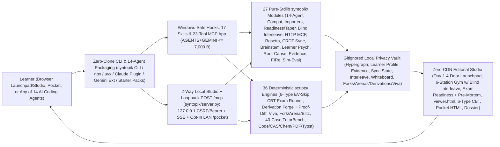

# Syntopik

**Personal AI Teacher & Cognitive Mastery OS — deterministic learner psychology, 14-coding-agent compatibility (stdio + zero-Node loopback `POST /mcp`), universal student importers (`.apkg`, `.ipynb`, CSV, Notion), 6-type EV-calibrated CBT & Exam Readiness Forecaster, Structural Isomorphism Rosetta transfer, FIRe-compressed FSRS-6 memory, offline CRDT sync, and a playable Mastery Gymnasium across any AI harness or browser.**

[](https://github.com/HridayKapoor/syntopik/actions/workflows/ci.yml)
[](./CHANGELOG.md)
[](#quick-start)
[](#visual-showcase)
[](./LICENSE)
[](#14-agent-universal-compatibility-stdio--zero-node-loopback-post-mcp)

> **Try it in 1 click (Zero Install):** [**Launch Live Interactive Syntopik Studio Demo →**](https://hridaykapoor.github.io/syntopik/)
>
> **Or launch locally in 10 seconds** with the calm **Day-1 4-Door Launchpad** or 3 zero-PII starter packs (*Raft Consensus*, *Simple Harmonic Motion*, *Transformers Attention*):
> ```bash
> npx github:HridayKapoor/syntopik demo --open
> # Or via pure Python 3.12+ stdlib (zero pip dependencies):
> uvx --from git+https://github.com/HridayKapoor/syntopik syntopik demo --open
> ```

Syntopik turns **any of 14 coding-agent harnesses** (**Google Antigravity 2.0**, **Anthropic Claude Code**, **OpenAI Codex / T3 Code**, **Cursor**, **Windsurf**, **VS Code / Copilot**, **Gemini CLI**, **OpenCode**, **Cline**, **Roo Code**, **Zed**, **Aider**, **Continue**, **Kiro**) — or a standalone loopback browser — into a calm, mathematically verified **Private Teacher & Deep-Mastery OS** for **any subject**: Computer Science, Distributed Systems, Machine Learning, Mathematics, Physics, Chemistry, Medicine, Research Papers, University Courses, and Competitive Exams (JEE, GATE, USMLE, Technical Screens).

---

## Visual Showcase

Zero-CDN, calm editorial interfaces in **Warm Obsidian & Vellum Ink** (Dark) and **Archival Vellum & Graphite** (Light) — live two-way via `syntopik serve` (`schemaVersion: 5` + SSE + loopback `POST /mcp`) and 100% functional offline via `file://`. On an empty workspace (`0` nodes), Studio opens a calm single-screen **Day-1 Zero-State 4-Door Launchpad** (2-min Non-VARK calibration · Universal Drop/Import · 1-Click Starter Packs · 14-Agent Connect) that smoothly transitions to full telemetry once your first concept lands.

<p align="center">
  <picture>
    <source media="(prefers-color-scheme: dark)" srcset="./docs/assets/dashboard-dark.png">
    <source media="(prefers-color-scheme: light)" srcset="./docs/assets/dashboard-light.png">
    
  </picture>
</p>
<p align="center">
  <sub><strong>Personal AI Teacher Studio (<code>dashboard.html</code>)</strong> — adapts automatically to your GitHub theme (<a href="./docs/assets/dashboard-dark.png">Dark</a> · <a href="./docs/assets/dashboard-light.png">Light</a>). Day-1 Zero-State 4-Door Launchpad, Adaptive Learner Profile &amp; overrides, Playable Mastery Gym + Live AI Chalkboard + Blind-Chapter Interleave, Exam Readiness Forecaster &amp; Pre-Mortem Shield, safe zero-<code>eval</code> <code>:::explore</code> slider labs, 365-day Retention Heatmap, Brier Calibration, FIRe Flashcards &amp; SVG Occlusion, Hypergraph &amp; 6-type EV-calibrated CBT Exams.</sub>
</p>

| Inline `Syntopik Studio` Cards (SEP-1865 MCP App) | Causal Knowledge Hypergraph (`viewer.html`) |
| :---: | :---: |
|  |  |
| Bare matched options, `"I don't know"` non-penalty button, `0–100%` confidence rail, thinking pad, keyboard-accessible `parsons` / `faded` / `blackout` practice cards, and server-sealed solutions. | Models conjunctive `premises[] -> conclusion` (`∧`) reasoning chains with `encompassWeight`, True FIRe + `0.25` Rosetta cross-domain credit, `T1–T4` Evidence Badges, amber causal-suspect halos, and live FSRS ratings. |

---

## Why Syntopik v3.2 Replaces a Static AI Prompt with a Real Private Teacher

| Existing Approach | Where It Breaks | How **Syntopik v3.2** Solves It |
| :--- | :--- | :--- |
| **Prompt-Only Socratic Wrappers** *(ChatGPT Study Mode, custom system prompts)* | Walls of text, session amnesia, sycophancy, VARK learning-style pseudoscience, unverified math/code, and no exam-day score forecast or taper guard. | **Closed-Loop Brainstem (`syntopik next`) + 3-Cadence Non-VARK Learner Psychology** (`<= 160`w ceilings, Kalyuga scaffolding, 6-state affect guardrails, `<= 72h` Pre-Exam Taper Mode, OOS replay calibration, `40/40` TutorBench). |
| **Standalone BYOK Apps & Locked Decks** *(Electron tutors, paywalled flashcard apps)* | Extra API bills, cloud lock-in, trapped Anki/Quizlet/Jupyter/Notion study assets, flat cards with zero prerequisite credit, mastery inflation from recognition alone. | **14-Agent Harness-Native + Zero-Node Loopback `POST /mcp`** (`27` pure-stdlib `syntopik/` modules, `dependencies = []`), **Zero-Fake-Mastery `.apkg`/`.ipynb`/CSV/Notion Importers**, **True FIRe + Rosetta `0.25` Credit**, **CRDT Multi-Device Sync**, and **4-Tier Evidence (`T1–T4`)**. |
| **Blocked Practice & Blind Cramming** *(single-chapter drills, guessing into negative marks)* | Students recognize chapters from headings, gamble into negative marks (`-EV`), cram new topics 24h before exams, and repeat the same traps on test day. | **Blind-Chapter Interleaved Drills (`syntopik interleave`)**, **6-Type CBT + Exact EV-Skip Calibration + Why-Wrong Distractor Autopsy**, **Exam-Day Readiness Forecaster + Top-3 ROI Levers**, and **Non-Fabricated 3-Bullet Pre-Mortem Shield (`syntopik readiness`)**. |

### 1. What's New in `v3.2.0` — Universal Access, Ecosystem Import & High-Stakes Exam Science
- **14-Coding-Agent Compatibility & Zero-Node Loopback `POST /mcp` (`syntopik/agents_compat.py`, `syntopik/mcp_http.py`, `syntopik doctor --compat`)**: Cross-OS detection and host-safe, zero-git-diff configuration across all **14 coding-agent harnesses** (`antigravity`, `claude`, `codex`, `cursor`, `windsurf`, `copilot`, `gemini`, `opencode`, `cline`, `roo`, `zed`, `aider`, `continue`, `kiro`) with ephemeral cache guards (`_npx`, `uv/archive-v0`, `pipx`, `/tmp`) and harness-exact schema support (Windsurf `serverUrl`, Copilot `servers`, Gemini `httpUrl`, OpenCode `mcp`, Cline `.clinerules` guard + `streamableHttp`, Roo `streamable-http`, Zed 9-file precedence guard + JSONC `context_servers`, Aider YAML `read:`, Continue `requestOptions.headers`, Kiro steering). `syntopik serve` also mounts a pure-Python **Streamable-HTTP MCP (`POST /mcp`)** server on `127.0.0.1` exposing all 7 headless tools with zero Node.js dependency (constant-time `X-Syntopik-Token`/`Bearer` auth, Origin DNS-rebinding guard, automatic `403` kill-switch under `--lan`).
- **4 Pure-Stdlib Student Ecosystem Importers (`syntopik/importers.py`, `syntopik import`)**: Bring existing study materials in seconds with strict **zero fake mastery** (every imported item starts `status: "planned"` with zero FSRS/revlog fabrication; existing `solid` mastery is never overwritten) and streaming zip-slip/zip-bomb/symlink guards:
  - **Anki `.apkg`** (`--kind anki`): read-only SQLite, Basic + Cloze (`kind: "cloze"`), HTML/MathJax cleanup, zstd `anki21b` handling.
  - **Quizlet / Anki CSV & TSV** (`--kind cards`): UTF-8 BOM-safe, Anki `#separator:`/`#deck:` directives, header aliases + headerless fallback.
  - **Jupyter Notebooks `.ipynb`** (`--kind notebook`): **zero code execution** (`json.loads` + `ast.parse` + `ast.literal_eval` only), extracts `notebook.md`, planned propositions, and `code-tests.json` verified directly by `code_verify.py test-cases`.
  - **Notion `.zip` & Obsidian/Markdown Folders** (`--kind notes_batch`): strips 32-hex & 36-char Notion UUID suffixes across folders, files, and internal URL-encoded links while extracting frontmatter, `:::cue`, `{{cN::...}}`, and `Q:: / A::` cues.
- **6-Type High-Stakes CBT Engine, EV-Skip Calibration & Distractor Autopsy (`scripts/exam_runner.py`, `demos/exam-cbt-template.html`)**: Extends `schemaVersion: 1` to all **6 question types** (`single_correct`, `multi_correct` w/ `jee_adv_msq`/`gate_msq`/`strict_all_or_nothing`/`proportional`, `numerical`, `matrix_match` w/ `grid`/`code_options` & `rowResults`, `assertion_reason` w/ deterministic `arErrorKind`, and `vignette_stem` shared clinical/passage/system-design stems w/ `vignetteBreakdown`). Strips per-option `whyWrong` rationales pre-submit and reveals a **Why-Wrong Distractor Autopsy** + exact **Expected-Value Skip Calibration** ($p_{\text{be}} = (P+U)/(B+P)$, `-EV` gambling loss, underconfident skips, `evDisciplineScore`) post-submit in both live and offline `file://` modes.
- **Exam-Day Readiness Forecaster, `<= 72h` Taper Mode & Pre-Mortem Shield (`syntopik/readiness.py`, `syntopik readiness`, `synt_readiness`)**: Deterministic 5-pillar readiness index (`0..100`) fusing FSRS-6 exam-day retention $R(t_{\text{exam}}, S)$, 4-tier Evidence depth, syllabus coverage, Blunder Fork clearance, and EV discipline into a Bayesian-shrunk score band and top-3 ROI levers (`roiMarksPerHour`). Auto-activates **Pre-Exam Taper Mode** (`<= 72h`, `allowNewConcepts: false`, sleep floor protection) inside `syntopik next` and generates a **strictly non-fabricated 3-bullet Gollwitzer If-Then Pre-Mortem Shield** exclusively from logged forks/mistakes/exams (returns `bullets: []` on empty logs).
- **Blind-Chapter Interleaved Drills (`syntopik/interleave.py`, `syntopik interleave`, `synt_interleave`)**: Rohrer multi-chapter interleaving across `>= 2` chapters with zero blocked runs (`chapter[i] != chapter[i-1]`), stripped chapter/lecture cues, server-sealed answers, **Step-1 governing-principle grading before Step-2 reveal**, cross-chapter surface-confusion matrix, and blind CBT spec export (`blindChapterLabels: true`).
- **Day-1 Zero-State 4-Door Launchpad (`dashboard.html`)**: Eliminates empty-workspace telemetry clutter — with `0` nodes, shows 4 calm doors (2-Min Calibration · Universal Drop/Import · 1-Click Starter Packs · 14-Agent Connect & Prompt) and seamlessly reveals full dashboards on concept #1.

### 2. Core Cognitive & Mastery Architecture (`v3.0` + `v3.1` Foundations)
- **3-Cadence Non-VARK Adaptive Learner Psychology (`syntopik/learner_model.py`)**: Rejects debunked VARK learning-style myths; combines optional 2-min Tier-1 calibration (Bayesian decay $6/(6+N)$), `< 90s` Tier-2 Pelánek 1PL/Elo placement, and continuous Tier-3 silent telemetry updating domain Elo, 3-tier Newman Failure DNA, 6 affective states, Kalyuga Expertise-Reversal scaffolding, transparent `userOverrides`, and 70/30 chronological OOS longitudinal replay (`syntopik calibrate-policy`).
- **Pedagogical Brainstem, Bayesian Causal Probing & 4-Tier Evidence (`syntopik/{brainstem,root_cause,evidence}.py`)**: Single `<= 180`-token move selector (`syntopik next` / `synt_next_move`), non-destructive Noisy-OR $\Delta H$ fault localization, SHA-256 hash-chained `T1–T4` Evidence Ledger, and zero-PII Mastery Dossiers (`syntopik export dossier`).
- **Structural Isomorphism Rosetta Engine + Offline CRDT Sync + Proof-Graph Diff (`syntopik/{isomorphism,sync_delta}.py`, `scripts/derivation_forge.py`)**: 10 cross-domain structural archetypes with `breaksAt` negative-transfer guards and `0.25` cross-domain FIRe credit (`syntopik rosetta`), SHA-256 tamper-evident CRDT multi-device sync (`syntopik sync-delta`), and handwritten proof-graph diffing with zero-leak `R0–R2` nudges (`syntopik proof-diff`).
- **Playable Mastery Gym, Live Chalkboard, Zero-`eval` `:::explore` Labs & Lifecycle Tools**: Live AI Chalkboard SSE + Reverse Pinning, Blunder Fork Dojo, Counterexample Arena, 4-Min ShadowBox Blitz + Blind-Chapter Interleave, Derivation Blackout & Axiom-Cut Bench, 5-Turn Adversarial Viva Defense Chamber, AST-whitelist RPN `:::explore` labs, Anti-Vibe-Coding Work Mentor (`syntopik debrief`), Semester Sunset (`syntopik sunset`), Multi-Course `.ics` Auto-Pacer (`syntopik pace`), 48h Pareto Triage (`syntopik triage`), Calm Catch-Up, ~20 KB Pocket HTML + opt-in LAN QR, and bidirectional Obsidian sync.

---

## 14-Agent Universal Compatibility (Stdio & Zero-Node Loopback `POST /mcp`)

Zero mandatory pip or npm dependencies (`dependencies = []` / `{}`) across **macOS, Linux, and Windows**. Run `syntopik doctor --compat` to inspect detected agents on your machine, or pass `--transport http` on `syntopik attach` to connect directly to `syntopik serve`'s pure-Python loopback `http://127.0.0.1:4173/mcp` endpoint (no Node.js required!).

| # | Coding Agent / Harness | 10-Second Setup Command | Native Config & Transport |
| :-: | :--- | :--- | :--- |
| 1 | **Google Antigravity 2.0** | `syntopik connect antigravity` | Global `~/.gemini/config/plugins/syntopik/` bundle + 23-tool SEP-1865 Studio (`stdio`) |
| 2 | **Anthropic Claude Code** | `/plugin marketplace add HridayKapoor/syntopik` → `/plugin install syntopik` | All 17 skills, `.mcp.json` / plugin MCP, Windows-safe hooks (`stdio` · `http`) |
| 3 | **OpenAI Codex / T3 Code** | `npx skills add HridayKapoor/syntopik && syntopik attach . --harness codex` | `.codex/config.toml` `[mcp_servers.syntopik-studio]` + `.codex/hooks.json` (`stdio` · `http`) |
| 4 | **Cursor** | `npx skills add HridayKapoor/syntopik && syntopik attach . --harness cursor` | `.cursor/rules/syntopik.mdc` + `.cursor/mcp.json` (`stdio` · `http`) |
| 5 | **Windsurf** | `npx skills add HridayKapoor/syntopik && syntopik attach . --harness windsurf` | `.windsurf/rules/syntopik.md` + global `mcp_config.json` (`serverUrl` HTTP · `stdio`) |
| 6 | **GitHub Copilot (VS Code)** | `npx skills add HridayKapoor/syntopik && syntopik attach . --harness copilot` | `.github/instructions/syntopik.instructions.md` + `.vscode/mcp.json` `"servers"` (`stdio` · `http`) |
| 7 | **Gemini CLI** | `gemini extensions install https://github.com/HridayKapoor/syntopik` | `gemini-extension.json`, `GEMINI.md` (`@AGENTS.md` L1), `.gemini/settings.json` (`httpUrl` HTTP · `stdio`) |
| 8 | **OpenCode** | `npx skills add HridayKapoor/syntopik && syntopik attach . --harness opencode` | `opencode.json` `"mcp"` (`local` stdio / `remote` HTTP) |
| 9 | **Cline** | `syntopik attach . --harness cline [--transport http]` | `.clinerules/syntopik.md` *(preserves existing regular file)* + `cline_mcp_settings.json` (`streamableHttp` · `stdio`) |
| 10 | **Roo Code** | `syntopik attach . --harness roo [--transport http]` | `.roo/rules/syntopik.md` + `.roo/mcp.json` (`streamable-http` · `stdio`) |
| 11 | **Zed** | `syntopik attach . --harness zed [--transport http]` | `.rules` *(first-match-safe)* + JSONC-safe `.zed/settings.json` `context_servers` (`stdio` · `http`) |
| 12 | **Aider** | `syntopik attach . --harness aider` | Non-destructive `.aider.conf.yml` `read:` merge → `.agents/syntopik-rules.md` (rules CLI) |
| 13 | **Continue** | `syntopik attach . --harness continue [--transport http]` | `.continue/rules/syntopik.md` + `.continue/mcpServers/syntopik.yaml` (`stdio` · `http`) |
| 14 | **Kiro** | `syntopik attach . --harness kiro [--transport http]` | `.kiro/steering/syntopik.md` + `.kiro/settings/mcp.json` (`stdio` · `http`) |
| — | **Browser / Zero-Clone** | `npx github:HridayKapoor/syntopik serve --open` *(or `syntopik demo --open`)* | Day-1 4-Door Launchpad + live 2-way Studio + loopback `POST /mcp` (`127.0.0.1:4173`) |

---

## Reproducible Quantitative Benchmarks (`Syntopik-Eval` & `TutorBench`)

Syntopik ships a deterministic, zero-LLM-cost 60-day multi-persona cognitive simulator (`syntopik/sim_eval.py`, `benchmarks/syntopik_bench.py`) evaluating **6 controlled ablation arms** across **5 mechanistic learner personas** on a **50-node / 5-chapter conjunctive hypergraph** (`seed=42`, `~335 ms`, enforced on every commit across Linux, macOS, and Windows):

```bash
syntopik bench --days 60 --seed 42 --check --markdown
python3 -B scripts/pedagogy_eval.py bench --json   # 40/40 TutorBench PASS (9 rubrics x 6 domains)
```

| Ablation Arm | Avg Reviews | Saved vs FSRS-6 | Final Ret. | 90d Ret. | Brier Score | ER Mismatch | Post-Absence | T3/T4 Transfer | Repeat Blunder |
| :--- | :---: | :---: | :---: | :---: | :---: | :---: | :---: | :---: | :---: |
| 0. SM-2 Flat | 479.2 | +12.3% | 94.2% | 80.5% | 0.220 | 33.6% | 32.8% | 21.6% | 17.9% |
| 1. FSRS-6 Flat | 546.4 | 0.0% | 94.5% | 84.0% | 0.207 | 30.2% | 39.8% | 33.6% | 15.8% |
| 2. + FIRe & SRC | 439.8 | +19.5% | 92.5% | 81.8% | 0.224 | 28.7% | 96.4% | 27.6% | 19.0% |
| 3. + Brier & Hyper | 411.0 | +24.8% | 93.4% | 84.4% | 0.192 | 30.0% | 98.3% | 34.8% | 15.6% |
| 4. + Learner Psych | 314.4 | +42.5% | 92.0% | 84.8% | 0.175 | 4.8% | 99.7% | 72.4% | 12.9% |
| **5. Syntopik Full** | **374.2** | **+31.5%** | **94.8%** | **89.2%** | **0.150** | **4.1%** | **98.6%** | **90.4%** | **12.2%** |

**7/7 Deterministic CI Regression Gates (vs. FSRS-6 Flat):** `+31.5%` reviews saved @ `94.8%` final / `89.2%` 90d retention · `-27.6%` Brier error (`0.150`) · `-86.5%` Expertise-Reversal mismatch (`4.1%`) · `98.6%` post-absence completion · `90.4%` T3/T4 transfer · `12.2%` repeat blunders · **`40/40` TutorBench PASS**.

<p align="center">
  
</p>
<p align="center">
  
</p>

---

## 3 Bundled Zero-PII Flagship Starter Packs (`packs/`)

Every starter pack is SHA-256 verified, 100% zero-PII (`syntopik pack verify`), and bundles propositions, conjunctive chains, traps, derivations, Blunder Forks, Counterexample Arenas, `:::explore` slider labs, `:::cue` mnemonic strips, and timed exams:

| Pack Slug | Domain | Bundled Mastery Content | Instant Launch Command |
| :--- | :--- | :--- | :--- |
| **`raft-consensus`** | Distributed Systems | 10 propositions · 7 chains · 3 topics · 3 traps · 1 derivation · 2 forks · 1 code arena · 1 `:::explore` · 2 `:::cue` · 4Q exam | `syntopik demo --pack raft-consensus --open` |
| **`shm-physics`** | Classical Mechanics | 10 propositions · 9 chains · 3 topics · 3 traps · 1 derivation · 2 forks · 1 math arena · 1 `:::explore` · 2 `:::cue` · 4Q JEE CBT | `syntopik demo --pack shm-physics --open` |
| **`transformers-attention`** | Machine Learning | 10 propositions · 8 chains · 3 topics · 3 traps · 1 derivation · 2 forks · 1 code arena · 1 `:::explore` · 2 `:::cue` · 4Q exam | `syntopik demo --pack transformers-attention --open` |

Verify all 3 packs locally anytime: `python3 -B scripts/build_starter_packs.py --verify-only --json`.

---

## System Architecture



---

## Verified Unified `syntopik` v3.2 CLI Reference

All **28 verified CLI verbs** run on **bare Python 3.12+ stdlib** (with native zero-Python Node support for `init`, `attach`, `sync`, `mcp`, `hook`):

| Command | Role |
| :--- | :--- |
| `syntopik demo [--pack raft-consensus\|shm-physics\|transformers-attention\|all] [--open] [--port 4173]` | Load bundled zero-PII starter pack(s) into `~/.syntopik-demo` and optionally open Studio in browser. |
| `syntopik next [--energy low\|normal\|deep] [--domain <name>] [--event <name>] [--json]` | **Pedagogical Brainstem**: emit the single highest-leverage teacher move (`<= 180`-token envelope + Rosetta + `<= 72h` taper + blind interleave). |
| `syntopik readiness [--exam-date YYYY-MM-DD] [--subject <name>] [--max-marks <N>] [--premortem-only] [--json]` | **Exam-Day Readiness Forecaster, Taper Mode & Pre-Mortem Shield**: project FSRS-6 $R(t_{\text{exam}})$, score band, top-3 ROI levers, `<= 72h` taper, and 3-bullet If-Then Shield. |
| `syntopik report [--days 7] [--md <path>] [--json]` | **Weekly Progress Report**: reviews, active days and streak, study time, accuracy, true retention vs FSRS target, mastery and due load, most-lapsed concepts, and one focus for next week — each compared with the previous window, all from logged evidence (`None`, never a fake zero, when there is no data). |
| `syntopik interleave [build\|check\|complete\|stats\|export-cbt] [--n 6] [--subjects <S>] [--mode principle_first] [--seed <N>] [--json]` | **Blind-Chapter Interleaved Drills**: zero-blocked-run cross-chapter drills stripping chapter cues, grading Step-1 governing principle first, or exporting blind CBT specs. |
| `syntopik import <target> [--kind auto\|anki\|cards\|notebook\|notes_batch\|youtube\|arxiv\|repo\|url\|notes] [--slug\|--chapter <slug>] [--register-tracker] [--pocket-sync <file>]` | **Universal Ecosystem Importer**: Anki `.apkg`, Quizlet/Anki CSV/TSV, Jupyter `.ipynb` (zero-exec AST tests), Notion `.zip`/MD folders (UUID stripping), YouTube, arXiv, repo, URL, Pocket sync. |
| `syntopik attach [dir] [--harness auto\|all\|<14 ids>] [--transport stdio\|http] [--http-url <url>] [--vault global\|local] [--copy-skills]` | Non-destructively wire Syntopik across **14 coding agents** via `.git/info/exclude` (never overwrites host `AGENTS.md`/`CLAUDE.md` or bakes ephemeral cache paths). |
| `syntopik connect <harness> [--bundle studio\|full] [--workspace <dir>]` | Install or print global plugin/extension configuration for any of the **14 coding-agent harnesses**. |
| `syntopik doctor [--compat] [--core-only] [--fix] [--workspace <dir>] [--json]` & `syntopik sync` | Audit workspace health, 27 stdlib modules, hooks, budgets, or print the **14-agent `--compat` matrix**; rebuild `graph-data.js`. |
| `syntopik serve [--port 4173] [--host 127.0.0.1] [--lan] [--open] [--workspace <dir>]` | Launch 2-way Studio + Mastery Gym + zero-Node loopback `POST /mcp` (`127.0.0.1`, CSRF/Bearer, SSE; `/mcp` blocked under `--lan`). |
| `syntopik rosetta [scan\|bridge\|link\|archetypes] [--prop-id <id>] [--source <id>] [--target <id>] [--archetype <id>] [--json]` | **Structural Isomorphism Rosetta Engine**: scan 10 archetypes, emit bijection openers, and link `isomorphic_to` chords (`0.25` FIRe). |
| `syntopik sync-delta [export\|merge\|verify\|status] [--out <path>] [--file <path>] [--since <iso>] [--dry-run] [--json]` | **Offline-First CRDT Sync**: export, SHA-256 verify, and monotonically merge multi-device `syntopik-delta-v1` snapshots. |
| `syntopik calibrate-policy [--apply] [--min-events 12] [--workspace <dir>] [--json]` | **Longitudinal Policy Replay**: 70/30 chronological TimeSeriesSplit replay adopting bounded gains `>= 0.005`. |
| `syntopik proof-diff --id <derivation_id> --steps-json <json_or_path> [--no-spawn-fork] [--json]` | **Proof-Graph Handwriting Diff**: align handwritten steps against `derivations.jsonl` with zero-leak `R0–R2` nudges, auto-fork & $\Delta H$ probe. |
| `syntopik profile [status\|calibrate\|policy\|override\|reset] [--prose-density terse\|standard\|rich] [--set KEY=VALUE]` | Inspect, calibrate (non-VARK Tier-1), compile Kalyuga `TeachingPolicy`, override, or reset Learner Profile. |
| `syntopik drop <inputs...> [--slug <slug>] [--title "<title>"] [--json]` | 10-second mixed-source kickoff (PDF, `.apkg`, `.ipynb`, CSV, Notion `.zip`, URL, YouTube, repo) with Teacher-First spine classification. |
| `syntopik debrief [--ref HEAD~1..HEAD \| --diff-file <path>] [--dry-run] [--json]` & `syntopik mode [mentor\|study] [--off]` | **Work Mentor**: crystallize git diff bugs into Blunder Forks, Arenas & KG nodes; toggle Mentor vs Study mode. |
| `syntopik sunset <slug> [--apply] [--json]` & `syntopik pace [--rebalance] [--ics <path>] [--json]` | **Semester Sunset** (archive leaves, keep axioms at $R=0.80$) & **Multi-Course Auto-Pacer** with RFC-5545 `.ics` export. |
| `syntopik board [status\|push\|pin\|clear] [--kind <kind>] [--title "<T>"] [--content "<C>"]` | Inspect or push frames/pins to the Live AI-to-Whiteboard SSE bus (`whiteboard-session.json`). |
| `syntopik bench [--days 60] [--seed 42] [--svg] [--markdown] [--check] [--json]` | Run the deterministic 60-day multi-persona `Syntopik-Eval` cognitive ablation benchmark & CI gate. |
| `syntopik init [dir] [--vault global\|local] [--workspace <dir>] [--json]` | Non-destructively initialize workspace or `~/.syntopik` vault (`< 2s`). |
| `syntopik review [--web\|--tui] [--recover --daily-cap 15 --days 6 --apply] [--resume] [--energy low\|normal\|deep]` | FIRe-compressed FSRS-6 reviews, TUI loop, calm backlog catch-up, or Cold-Start Re-Entry Brief. |
| `syntopik triage [--exam-in 48h\|--hours 48] [--sleep-hours 7] [--chapter <slug>] [--crib-sheet]` | Pareto 48h exam triage schedule + 1-page Anti-Mastery Typst crib sheet spec. |
| `syntopik pack <export\|inspect\|verify\|import> [args...]` & `syntopik export <obsidian\|pocket\|anki\|pack\|json\|dossier>` | Zero-PII `.syntopik-pack.zip` packs; export Obsidian vault, ~20 KB Pocket HTML, Visual Anki `.apkg`, JSON, or Mastery Dossier. |
| `syntopik run <engine> [args...]` | Portable passthrough to any bundled `scripts/` engine (e.g., `syntopik run exam_runner schema`, `syntopik run pedagogy_eval bench`). |

---

## Quick Start

### Option A — Core-Only or Zero-Clone (Zero Pip/Npm Dependencies · `< 2s`)

Requires only **Python 3.12+** (Node.js 20+ optional — `syntopik serve` even exposes zero-Node loopback `POST /mcp`!). Immediately powers the Day-1 4-Door Launchpad, `syntopik demo`, `syntopik serve`, 14-agent `attach`/`doctor --compat`, `.apkg`/`.ipynb`/CSV/Notion importers, 6-type EV-skip CBT exams, Exam Readiness / Taper / Pre-Mortem, Blind-Chapter Interleave, Adaptive Learner Psychology, Brainstem, Causal Probing, 4-Tier Evidence, FIRe/FSRS-6, Mastery Gym, `:::explore` labs, Work Mentor, `Syntopik-Eval`, and 40-case TutorBench:

```bash
# Instant zero-clone interactive demo:
npx github:HridayKapoor/syntopik demo --open

# Or from a local clone (macOS / Linux / Windows):
git clone https://github.com/HridayKapoor/syntopik.git
cd syntopik
python -B scripts/setup_harness.py auto
python -B scripts/study_doctor.py --core-only
python -B scripts/study_doctor.py --compat
python -B benchmarks/syntopik_bench.py --days 60 --seed 42 --check --markdown
```

### Option B — Full STEM Suite (`requirements-stem.txt` + `chempy --no-deps`)

Adds PDF/OCR triage & SVG occlusion (`pdf_studio.py`), SymPy/Pint CAS math & plots, SciPy L-BFGS-B FSRS-6 optimization, RDKit/ChemPy chemistry, Schemdraw circuits, NetworkX graph intelligence, Manim animations, neural audio briefs, and Visual Anki `.apkg` export:

```bash
git clone https://github.com/HridayKapoor/syntopik.git
cd syntopik

uv venv --python 3.12 .venv
uv pip install -r requirements-stem.txt
uv pip install --no-deps chempy

.venv/bin/python -B scripts/setup_harness.py auto
.venv/bin/python -B scripts/study_doctor.py
.venv/bin/python -B -m unittest discover -s tests -v
```

> **Dependency note**: Install `chempy` with `--no-deps` (avoids pulling ~70 Jupyter packages via `pyodesys`) and never install `mendeleev` (conflicts with modern `pint`; Syntopik uses `molmass`). Optional system binaries (`typst`, `ffmpeg`, `TinyTeX`) unlock 1–2p Typst revision & Anti-Mastery PDFs, narrated audio/video, and Manim LaTeX rendering.

---

## Start Learning in Two Prompts (Plain-English Routing)

Syntopik routes plain English automatically — zero student CLI logistics required:

- **Start cold or import existing study decks**: `Teach me Raft Consensus from scratch.` · `Load the Transformers starter pack.` · `Import my Anki deck @sources/biology.apkg or @sources/cs229-lab.ipynb.`
- **Drop mixed sources**: `Start from https://arxiv.org/abs/1706.03762` · `Import https://youtu.be/<id>` · `Start SHM from @sources/shm/ using my lecture notes as the spine.`
- **Resume any day**: `Continue` *(runs Brainstem `synt_next_move`, respects Active TeachingPolicy & `<= 72h` Taper Mode, resolves pinned Whiteboard questions, or opens a 90s Cold-Start Re-Entry Brief after `>= 4` days away!)*
- **Exam Prep, Mastery Gym & Lifecycle triggers**:
  - `Am I ready for my exam on 2026-12-15?` · `Show my Pre-Mortem Shield` → Exam Readiness Forecaster, top-3 ROI levers, `<= 72h` taper & 3-bullet If-Then Shield
  - `Mix chapters for a blind drill` → Rohrer Blind-Chapter Interleaved Drill (Step-1 principle before Step-2 reveal)
  - `Build a 6-type CBT mock` → timed CBT with `assertion_reason`, `vignette_stem`, EV-skip calibration & Why-Wrong Distractor Autopsy
  - `Calibrate how I learn` · `Blunder Fork` · `Counterexample Arena` · `4-min First-Move Blitz` · `Derivation Blackout` · `Axiom-Cut` · `Viva Defense` · `Debrief my last commit` · `5-min review` · `I fell behind` · `Exam in 48 hours` · `Sunset <chapter>`

---

## Exact v3.2.0 Component Inventory

- **Turn-0 Context Budget & Health Gates**: Tightened `AGENTS.md` + `GEMINI.md` (`@AGENTS.md` on line 1) **`<= 7,000 B`** (well below the `9,500 B` hard ceiling); `CLAUDE.md` (`@AGENTS.md` on line 1, `21` lines); exact **`17` portable skills** (`<= 3,400 B` total YAML descriptions, `<= 215` chars each, zero `<...>` or script filenames); **`49/49`** full doctor & **`16/16`** `--core-only` doctor (`0 warn, 0 fail`).
- **27 Pure-Stdlib Core Modules (`syntopik/`, `dependencies = []`) + 10 Rosetta Archetypes (`syntopik/data/archetypes.json`)**: `__init__.py`, `paths.py`, `storage.py`, `schemas.py`, `fsrs_core.py`, `learner_model.py`, `root_cause.py`, `evidence.py`, `brainstem.py`, `explorable.py`, `work_mentor.py`, `whiteboard.py`, `sim_eval.py`, `isomorphism.py`, `sync_delta.py`, `agents_compat.py`, `importers.py`, `interleave.py`, `mcp_http.py`, `readiness.py`, `ingest.py`, `obsidian.py`, `forks.py`, `packs.py`, `pocket.py`, `server.py`, `cli.py` (**28 unified CLI verbs**).
- **36 Local Deterministic Engines (`scripts/` — 35 Python + 1 Node) + `benchmarks/syntopik_bench.py`**:
  - *Psychology, Memory, Brainstem, Sync & Benchmarks*: `learner_profile.py`, `srs_engine.py`, `graph_intel.py`, `daily_plan.py`, `chapter_tracker.py`, `mistake_analytics.py`, `pedagogy_eval.py` (`40/40` TutorBench), `benchmarks/syntopik_bench.py` (`7/7` ablation gates + `--replay`), `build_starter_packs.py`, `setup_harness.py`, `study_doctor.py` (`--compat`), `backup_harness.py`, `install_mcp_app.py`, `sync-graph.mjs` (`schemaVersion: 5`).
  - *Mastery Gym & 6-Type CBT Exams*: `exam_runner.py` (6 types, EV-skip calibration, Why-Wrong Distractor Autopsy), `fork_replay.py`, `falsify_arena.py`, `decision_blitz.py`, `derivation_forge.py` (blackout + axiom-cut + `diff`), `viva_chamber.py`.
  - *Ingestion, Obsidian, CS, Math, Physics, Chemistry, PDFs & Media*: `ingest_source.py`, `research_scout.py`, `vault_sync.py`, `code_verify.py`, `math_verify.py`, `math_plot.py`, `physics_draw.py`, `circuit_draw.py`, `chem_physical.py`, `chem_3d.py`, `organic_reagents.py`, `eduniti_pyq.py`, `pdf_studio.py`, `cheatsheet_pdf.py`, `audio_brief.py`, `manim_helpers.py`, `narrate_video.py`.
- **17 Progressive-Disclosure Skills (`.agents/skills/` mirrored at `.claude/skills/`)**:
  `topic-onboarding` · `chapter-autopilot` · `teach-chapter` · `practice-drill` · `grade-handwriting` · `exam-simulator` · `universal-pdf-study` · `ingest-chapter` · `visual-and-demo` · `revision-sheets` · `knowledge-graph` · `physics-circuits-and-units` · `physical-chemistry` · `organic-chemistry-tutor` · `manim-animator` · `subagent-orchestrator` · `harness-self-improve`.
- **23 MCP Tools (`mcp-app/mlh-studio/` v3.2.0 — `syntopik-studio`) + 7 Zero-Node Loopback HTTP MCP Tools (`POST /mcp`)**:
  `synt_quiz_card`, `synt_practice_card` (`standard`/`parsons`/`faded`/`blackout`), `synt_lesson_studio`, 5 internal app-only studio tools, 7 ambient headless tools (`synt_next_move`, `synt_whiteboard_step`, `synt_capture_concept`, `synt_get_frontier` w/ `readinessSummary` & `taperActive`, `synt_log_review`, `synt_readiness`, `synt_interleave`), plus 8 backwards-compatible `mlh_*` aliases (`15 synt_* + 8 mlh_* = 23`).

---

## Documentation, Security & License

- [`BOOTSTRAP.md`](./BOOTSTRAP.md) — 10-second **14-agent** integration guide, loopback `POST /mcp`, `syntopik` v3.2 CLI reference & 4-axis UX matrix.
- [`SELF_IMPROVEMENT_BLUEPRINT.md`](./SELF_IMPROVEMENT_BLUEPRINT.md) — Complete engineering record through Phase 8 (`v3.2.0`), regression watchlist & forward roadmap.
- [`CONTRIBUTING.md`](./CONTRIBUTING.md) — Architecture invariants, `9,500 B` context budget, `40/40` TutorBench & `Syntopik-Eval` verification gates.
- [`SECURITY.md`](./SECURITY.md) — Local-first privacy, `127.0.0.1` CSRF/Bearer & `--lan` kill-switches (incl. `/mcp`), zero-PII fail-closed packs, tamper-evident CRDT sync, zero-exec `.ipynb` AST extraction, AST-whitelist RPN, and sandbox boundaries.
- [`CHANGELOG.md`](./CHANGELOG.md) — Full release history (`v3.2.0`, `v3.1.0`, `v3.0.0`, `v2.0.0`, `v1.0.0`).
- Licensed under the [MIT License](./LICENSE).
