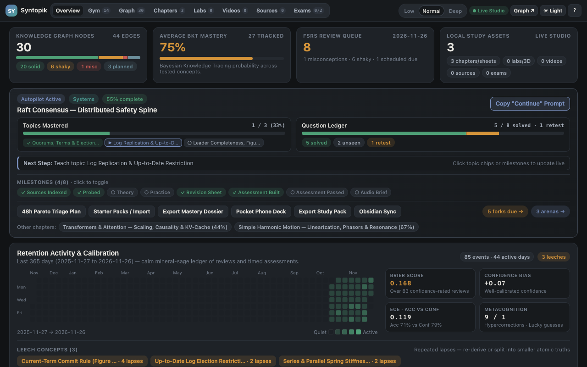
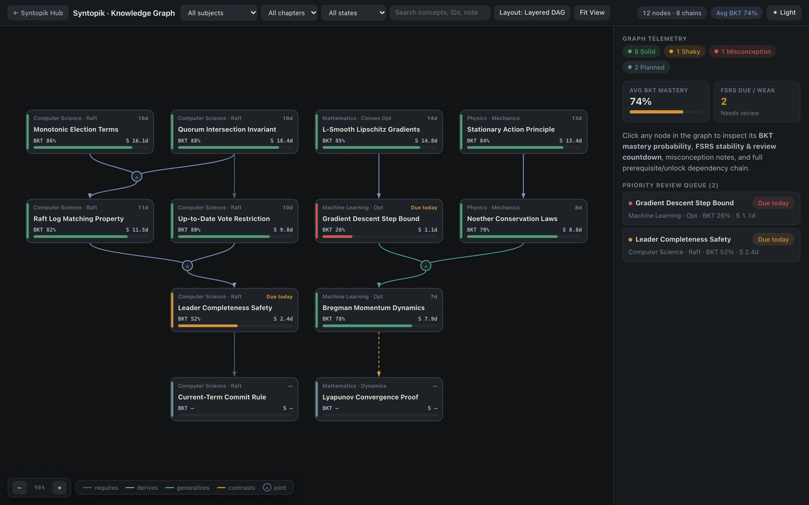
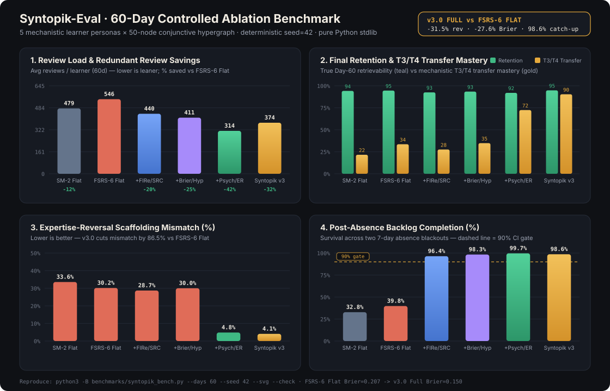
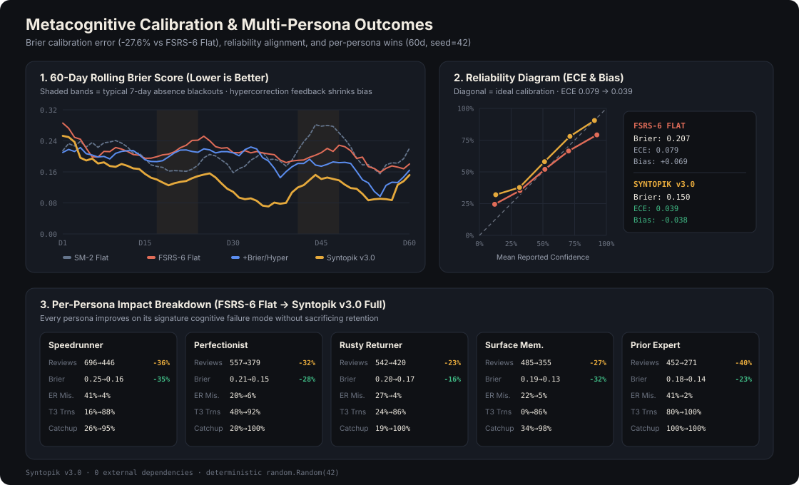
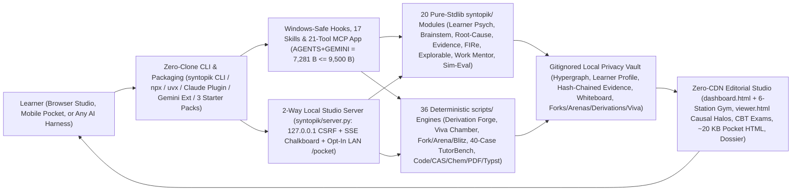

# Syntopik

**Personal AI Teacher & Cognitive Mastery OS — deterministic learner psychology, Bayesian causal root-cause probing, FIRe-compressed FSRS-6 memory, and a playable 6-station Mastery Gymnasium across any AI harness or browser.**

[](https://github.com/HridayKapoor/syntopik/actions/workflows/ci.yml)
[](./CHANGELOG.md)
[](#quick-start)
[](#visual-showcase)
[](./LICENSE)
[](#integrate-with-anything-in-10-seconds)

> **Try it in 1 click (Zero Install):** [**Launch Live Interactive Syntopik Studio Demo →**](https://hridaykapoor.github.io/syntopik/)
>
> **Or launch locally in 10 seconds** with 3 curated zero-PII starter packs (*Raft Consensus*, *Simple Harmonic Motion*, *Transformers Attention*):
> ```bash
> npx github:HridayKapoor/syntopik demo --open
> # Or via pure Python 3.12+ stdlib (zero pip dependencies):
> uvx --from git+https://github.com/HridayKapoor/syntopik syntopik demo --open
> ```

Syntopik turns the AI coding harness you already use (**Google Antigravity 2.0**, **Anthropic Claude Code**, **Cursor**, **Windsurf**, **VS Code / Copilot**, **OpenAI Codex / T3 Code**, **Gemini CLI**, **OpenCode**) — or a standalone loopback browser — into a calm, mathematically verified **Private Teacher & Deep-Mastery OS** for **any subject**: Computer Science, Distributed Systems, Machine Learning, Mathematics, Physics, Chemistry, Research Papers, University Courses, and Competitive Exams.

---

## Visual Showcase

Zero-CDN, calm editorial interfaces in **Warm Obsidian & Vellum Ink** (Dark) and **Archival Vellum & Graphite** (Light) — live two-way via `syntopik serve` (`schemaVersion: 5` + SSE) and 100% functional offline via `file://`.

<p align="center">
  <picture>
    <source media="(prefers-color-scheme: dark)" srcset="./docs/assets/dashboard-dark.png">
    <source media="(prefers-color-scheme: light)" srcset="./docs/assets/dashboard-light.png">
    
  </picture>
</p>
<p align="center">
  <sub><strong>Personal AI Teacher Studio (<code>dashboard.html</code>)</strong> — adapts automatically to your GitHub theme (<a href="./docs/assets/dashboard-dark.png">Dark</a> · <a href="./docs/assets/dashboard-light.png">Light</a>). Adaptive Learner Profile &amp; override toggles, 6-Station Playable Mastery Gym + Live AI Chalkboard, safe zero-<code>eval</code> <code>:::explore</code> slider labs, 365-day Retention Heatmap, Brier Calibration, FIRe Flashcards &amp; SVG Occlusion, 48h Triage, Hypergraph, Mnemonic Reader &amp; CBT Exams.</sub>
</p>

| Inline `Syntopik Studio` Cards (SEP-1865 MCP App) | Causal Knowledge Hypergraph (`viewer.html`) |
| :---: | :---: |
|  |  |
| Bare matched options, `"I don't know"` non-penalty button, `0–100%` confidence rail, thinking pad, keyboard-accessible `parsons` / `faded` / `blackout` practice cards, and server-sealed solutions. | Models conjunctive `premises[] -> conclusion` (`∧`) reasoning chains with `encompassWeight`, True FIRe prerequisite credit, `T1–T4` Evidence Badges, amber causal-suspect halos, and live FSRS ratings. |

---

## Why Syntopik v3.0 Replaces a Static AI Prompt with a Real Private Teacher

| Existing Approach | Where It Breaks | How **Syntopik v3.0** Solves It |
| :--- | :--- | :--- |
| **Prompt-Only Socratic Wrappers** *(ChatGPT Study Mode, custom system prompts)* | Walls of text, session amnesia, sycophancy, VARK learning-style pseudoscience, unverified math/code, and guessing what to teach next. | **Closed-Loop Brainstem (`syntopik next`) + 3-Cadence Non-VARK Learner Psychology** (`<= 160`w calm ceilings, Kalyuga Expertise-Reversal scaffolding, 6-state affect guardrails, zero VARK myths, verified `40/40` TutorBench). |
| **Standalone BYOK Apps & Paid Flashcard Decks** *(Electron tutors, paywalled mobile apps)* | Extra API bills, flat cards with zero prerequisite credit, mastery inflation from MCQ recognition alone, red-backlog burnout after missed weeks. | **100% Harness-Native + Zero-Clone `syntopik serve`** (`20` pure-stdlib `syntopik/` modules, `dependencies = []`), **True FIRe + SRC**, **4-Tier Evidence Ledger (`T1–T4`)**, **Calm Catch-Up**, and **Free ~20 KB Offline Pocket HTML5 Deck**. |
| **Passive RAG & Vibe-Coding Loops** *(NotebookLM → Chat → copy-paste code)* | *Epistemic Drift* (unverified claims memorized), superficial completion without diagnosing prerequisite breaks, coding bugs never turned into durable mental models. | **Bayesian Noisy-OR Causal Root-Cause Probing ($\Delta H$)** + **Playable 6-Station Mastery Gym** + **Anti-Vibe-Coding Work Mentor (`syntopik debrief`)** + **Deterministic CAS / Code / Chemistry Verifiers**. |

### 1. Three-Cadence Non-VARK Adaptive Learner Psychology (`syntopik/learner_model.py`)
Syntopik explicitly rejects debunked VARK ("visual / auditory / kinesthetic") learning-style myths (Pashler et al., Rogowsky et al.) and instead implements empirically grounded **Aptitude-Treatment Interaction (ATI)**:
- **Cadence 1 — Optional 2-Minute Onboarding Calibration (`syntopik profile calibrate`)**: Captures entry-ramp preference, challenge appetite, session duration, and prose density (`105 / 135 / 155`w caps) with **Bayesian prior decay** $w = 6 / (6 + N)$ so behavioral telemetry smoothly supersedes self-report.
- **Cadence 2 — `< 90s` Per-Chapter Placement**: 2–3 adaptive Pelánek 1PL/Elo probes with automatic bypass for already-`solid` KG prerequisites ($R \ge 0.80$) and 2-probe early stopping.
- **Cadence 3 — Continuous Silent Adaptation (Every Turn)**: Updates per-domain Pelánek Elo ($K(n_d) = \max(16, 64 / (1 + 0.05\,n_d))$), 3-tier Newman **Failure DNA**, and **6-State Affective Guardrails** (`flow`, `productive_confusion`, `overloaded_frustrated`, `bored_underchallenged`, `gaming_rushing`, `fatigued`) from latency, hint rungs (`R0–R5`), and Brier calibration. Automatically shifts **Kalyuga Expertise-Reversal** scaffolding (`worked_example_parsons` → `faded` → `standard` → `challenge_transfer`) while keeping every knob transparently overridable (`syntopik profile override --set ...` or the Studio UI override strip).

### 2. Pedagogical Brainstem, Bayesian Causal Root-Cause Probing & 4-Tier Evidence Ledger
- **Single Teacher Control Loop (`syntopik next` / `synt_next_move`, `syntopik/brainstem.py`)**: Deterministic 10-priority selector fusing unresolved whiteboard pins, onboarding calibration, cold-start re-entry, causal root-cause probes, Blunder Forks, FIRe/SRC reviews, T3/T4 bottlenecks, and frontier topics into a compact `<= 180`-token Action Envelope. Pair with `syntopik drop <inputs...>` for 10-second mixed-source kickoff locking instructor notes as the `#1` **Teacher-First** spine.
- **Bayesian Noisy-OR Causal Fault Localizer (`syntopik/root_cause.py`)**: Models conjunctive prerequisite chains $P(\text{pass } C \mid P_1..P_k) = (1-s_C)\prod_i P(P_i)^{w_i}$ non-destructively (never mutating `solid` nodes), selects the single ancestor probe maximizing expected Shannon entropy reduction $\Delta H$, and highlights causal suspect halos + cross-chapter blast radius in `viewer.html`.
- **SHA-256 Hash-Chained 4-Tier Epistemic Evidence Ledger (`syntopik/evidence.py`)**: Separates `T1` (Recognition) / `T2` (Guided Recall) / `T3` (Cold Transfer) / `T4` (Adversarial Viva Defense / Axiom-Cut), fires anti-inflation alerts when bottleneck concepts claim `solid` on recognition alone, and exports a tamper-evident, zero-PII, zero-CDN standalone HTML **Mastery Dossier** (`syntopik export dossier`).

### 3. Playable 6-Station Mastery Gymnasium, Live Chalkboard, Safe `:::explore` Labs & Work Mentor
- **Playable Mastery Gym (`dashboard.html` `Gym` tab + `syntopik serve`)**:
  1. **Live AI Chalkboard (`syntopik/whiteboard.py`, `synt_whiteboard_step`, `syntopik board`)**: Progressive frames pushed over SSE (`derivation_step`, blurred `prediction_gate` unlocked on learner prediction + confidence, `explore_widget`, `diagram_callout`, `summary`) with **Reverse Pinning** so learners pin any confusing step right back to the AI agent.
  2. **Blunder Fork Dojo (`syntopik/forks.py`, `scripts/fork_replay.py`)**: Re-tests mutated mid-flight blunder checkpoints days later with Woodpecker latency tracking and repeat-blunder refutation without leaking `sealedWinningMove`.
  3. **Counterexample Arena (`scripts/falsify_arena.py`)**: Kill server-sealed Conceptual Mutants via isolated code/math sandboxes (strict zero survivor leak) and commit a 1-line **Lakatos Lemma Repair** into `boundaryConditions[]`.
  4. **4-Min ShadowBox First-Move Blitz (`scripts/decision_blitz.py`)**: 6 interleaved lookalikes, zero solving — pick Kill-Cue, First Move, and Rejected Decoy against the Expert Lens.
  5. **Derivation Blackout & Axiom-Cut Bench (`scripts/derivation_forge.py`, `synt_practice_card(mode="blackout")`)**: Progressive step-DAG reconstruction accepting alternate algebraic paths + BFS **Axiom-Cut Surgery** (*delete one assumption, locate the earliest step that breaks, state what survives*).
  6. **Adversarial Viva Voce Defense Chamber (`scripts/viva_chamber.py`)**: 5-turn Commitment-Ledger oral/text examiner (with optional zero-weight browser `SpeechRecognition` dictation) scoring 4 rubric axes and demoting fragile `solid` nodes back to `shaky` on boundary collapse.
- **Safe Zero-`eval` `:::explore` Slider Labs (`syntopik/explorable.py`)**: Declarative 10-line `:::explore` blocks inside chapter notes compiled via a strict AST-whitelist RPN compiler into interactive sliders, Exact-vs-Approximation Regime-Break SVG curves, and Mahajan Limiting-Case prediction gates — **zero `eval()` / `new Function()`**.
- **Anti-Vibe-Coding Work Mentor (`syntopik/work_mentor.py`, `syntopik debrief`, `syntopik mode mentor`)**: Scans `git diff` (rejecting `-` flag injection) across 6 bug classes to crystallize real coding bugs into Blunder Forks, Arenas, and KG propositions; silent passthrough for verified `solid` (`T3+`) concepts, 20-second micro-prediction gate for `shaky` areas.
- **Real-World Student-Life Lifecycle**:
  - **Post-Exam Semester Sunset (`syntopik sunset <slug> --apply`)**: Snapshots finished chapters to `chapters/_archived/*.syntopik-pack.zip`, retires ~80% leaf trivia (`archived: true`), and keeps ~20% load-bearing axioms at $R=0.80$.
  - **Multi-Course Buffer-Protected Auto-Pacer + `.ics` (`syntopik pace --rebalance --ics study.ics`)**: 20% guilt-free slack buffer across multiple exams + pure-stdlib RFC-5545 calendar export.
  - **48-Hour Exam Triage & Anti-Mastery Crib Sheet (`syntopik triage --exam-in 48h --sleep-hours 7 --crib-sheet`)**, **Calm Backlog Recovery (`syntopik review --recover --daily-cap 15`)**, **Cold-Start Re-Entry (`syntopik review --resume`)**, **Offline ~20 KB Pocket Commute HTML + Opt-In LAN QR (`syntopik export pocket`, `syntopik serve --lan`)**, **Universal Ingestion (`syntopik import`)**, and **Bidirectional Obsidian / Mnemonic Sync (`syntopik export obsidian`)**.

---

## Reproducible Quantitative Benchmarks (`Syntopik-Eval` & `TutorBench`)

Syntopik ships a deterministic, zero-LLM-cost 60-day multi-persona cognitive simulator (`syntopik/sim_eval.py`, `benchmarks/syntopik_bench.py`) evaluating **6 controlled ablation arms** across **5 mechanistic learner personas** on a **50-node / 5-chapter conjunctive hypergraph** (`seed=42`, `335 ms`, enforced on every commit across Linux, macOS, and Windows):

```bash
syntopik bench --days 60 --seed 42 --check --markdown
python3 -B scripts/pedagogy_eval.py bench --json   # 40/40 TutorBench PASS (9 rubrics x 6 domains)
```

| Ablation Arm | Avg Reviews | Saved vs FSRS-6 | Final Ret. | 90d Ret. | Brier Score | ER Mismatch | Post-Absence | T3/T4 Transfer | Repeat Blunder |
| :--- | :---: | :---: | :---: | :---: | :---: | :---: | :---: | :---: | :---: |
| 0. SM-2 Flat | 479.2 | +12.3% | 94.2% | 80.5% | 0.220 | 33.6% | 32.8% | 21.6% | 17.9% |
| 1. FSRS-6 Flat | 546.4 | 0.0% | 94.5% | 84.0% | 0.207 | 30.2% | 39.8% | 33.6% | 15.8% |
| 2. + FIRe & SRC | 439.8 | +19.5% | 92.5% | 81.8% | 0.224 | 28.7% | 96.4% | 27.6% | 19.0% |
| 3. + Brier & Hyper | 411.0 | +24.8% | 93.4% | 84.4% | 0.192 | 30.0% | 98.3% | 34.8% | 15.6% |
| 4. + Learner Psych | 314.4 | +42.5% | 92.0% | 84.8% | 0.175 | 4.8% | 99.7% | 72.4% | 12.9% |
| **5. Syntopik v3.0 Full** | **374.2** | **+31.5%** | **94.8%** | **89.2%** | **0.150** | **4.1%** | **98.6%** | **90.4%** | **12.2%** |

**7/7 Deterministic CI Regression Gates (vs. FSRS-6 Flat):**
- **`+31.5%` Reviews Saved** (`374.2` vs `546.4`) while achieving **`94.8%` Final Retention** (`>= 94.5%`) and **`89.2%` 90-Day Retention** (`+5.2pp`).
- **`-27.6%` Brier Calibration Error** (`0.150` vs `0.207`).
- **`-86.5%` Expertise-Reversal Mismatch** (`4.1%` vs `30.2%`).
- **`98.6%` Post-Absence Completion** (vs `39.8%` flat FSRS-6 backlog burnout).
- **`90.4%` T3/T4 Transfer Mastery** (`+56.8pp` over `33.6%`) and **`12.2%` Repeat-Blunder Rate** (down from `15.8%`).
- **`40/40` TutorBench Pedagogical Linter PASS** across 9 rubrics (`adaptive_explanation`, `error_feedback`, `scaffolding_hinting`, `vark_myth_refusal`, `expertise_reversal`, `gaming_rushing_intervention`, `fatigue_calm_wrapup`, `causal_root_probe`, `anti_inflation_and_zero_leak`) × 6 domains (`CS`, `ML`, `Math`, `Physics`, `Chemistry`, `Systems`).

<p align="center">
  
</p>
<p align="center">
  
</p>

---

## 3 Bundled Zero-PII Flagship Starter Packs (`packs/`)

Every starter pack is SHA-256 verified, 100% zero-PII (`syntopik pack verify`), and bundles propositions, conjunctive chains, traps, derivations, Blunder Forks, Counterexample Arenas, `:::explore` slider labs, `:::cue` mnemonic strips, and timed exams:

| Pack Slug | Domain | Bundled Mastery Content | Instant Launch Command |
| :--- | :--- | :--- | :--- |
| **`raft-consensus`** | Distributed Systems | 10 propositions · 7 chains · 3 topics · 3 traps · 1 derivation · 2 forks · 1 code arena · 1 `:::explore` · 2 `:::cue` · 4Q exam | `syntopik demo --pack raft-consensus --open` |
| **`shm-physics`** | Classical Mechanics | 10 propositions · 9 chains · 3 topics · 3 traps · 1 derivation · 2 forks · 1 math arena · 1 `:::explore` · 2 `:::cue` · 4Q JEE CBT | `syntopik demo --pack shm-physics --open` |
| **`transformers-attention`** | Machine Learning | 10 propositions · 8 chains · 3 topics · 3 traps · 1 derivation · 2 forks · 1 code arena · 1 `:::explore` · 2 `:::cue` · 4Q exam | `syntopik demo --pack transformers-attention --open` |

Verify all 3 packs locally anytime: `python3 -B scripts/build_starter_packs.py --verify-only --json`.

---

## Integrate With Anything in 10 Seconds

Zero mandatory pip or npm dependencies (`dependencies = []` / `{}`) across **macOS, Linux, and Windows**.

| User / Harness | 10-Second Command | What Works Immediately |
| :--- | :--- | :--- |
| **Live Browser Demo (Zero Install)** | [hridaykapoor.github.io/syntopik](https://hridaykapoor.github.io/syntopik/) | Full interactive Teacher Studio, Mastery Gym, `:::explore` labs, and 3 starter packs directly in your browser. |
| **Zero-Clone Local Studio** | `npx github:HridayKapoor/syntopik demo --open`<br>`uvx --from git+https://github.com/HridayKapoor/syntopik syntopik serve --open` | Auto-creates `~/.syntopik` (or `~/.syntopik-demo`), launches 2-way Studio (`http://127.0.0.1:4173`) with Live Chalkboard, Mastery Gym, FIRe flashcards, SVG occlusion, URL/PDF drop, and CBT exams. |
| **Claude Code (Any Repo)** | `/plugin marketplace add HridayKapoor/syntopik`<br>`/plugin install syntopik` | All 17 `/syntopik:*` skills, 21-tool `syntopik-studio` v3.0 MCP App (incl. `synt_next_move` & `synt_whiteboard_step`), and Windows-safe, plugin-cache-safe hooks. |
| **Cursor / Windsurf / Copilot / Codex / OpenCode** | `npx skills add HridayKapoor/syntopik`<br>`npx github:HridayKapoor/syntopik attach .` | Auto-detects installed harnesses (`--harness auto`), wires thin pointer rules + native MCP configs (`.vscode/mcp.json` `"servers"`, `opencode.json` `"mcp"`, `.cursor/mcp.json`, `.codex/config.toml`) + `.git/info/exclude` with zero diff to host `AGENTS.md` or `.gitignore`. |
| **Google Antigravity 2.0 (Any Repo)** | `syntopik connect antigravity`<br>*(or `uvx --from git+https://github.com/HridayKapoor/syntopik syntopik connect antigravity`)* | Installs global `~/.gemini/config/plugins/syntopik/` bundle (`plugin.json`, 17 skills, rules, hooks, and 21-tool SEP-1865 Studio v3.0 MCP App). |
| **Gemini CLI (Any Repo)** | `gemini extensions install https://github.com/HridayKapoor/syntopik` | Installs `gemini-extension.json`, `GEMINI.md` (`@AGENTS.md` on line 1), 17 skills, hooks, and `syntopik-studio` v3.0 MCP server. |
| **Standalone Clone / Full STEM** | `git clone https://github.com/HridayKapoor/syntopik && cd syntopik && syntopik serve --open` | Adds optional local SymPy/Pint, RDKit/ChemPy, Schemdraw, Typst, RapidOCR, Manim, and offline `file://` fallback. |

---

## System Architecture



---

## Verified Unified `syntopik` v3.0 CLI Reference

Every command and flag below is verified against `syntopik/cli.py` and `bin/syntopik.mjs` and runs on **bare Python 3.12+ stdlib** (with native zero-Python Node support for `init`, `attach`, `sync`, `mcp`, `hook`):

| Command | Role |
| :--- | :--- |
| `syntopik demo [--pack raft-consensus\|shm-physics\|transformers-attention\|all] [--open] [--port 4173]` | Load bundled zero-PII starter pack(s) into `~/.syntopik-demo` and optionally open Studio in browser. |
| `syntopik next [--energy low\|normal\|deep] [--domain <name>] [--event <name>] [--json]` | **Pedagogical Brainstem**: emit the single highest-leverage teacher move (`<= 180`-token envelope). |
| `syntopik profile [status\|calibrate\|policy\|override\|reset] [--prose-density terse\|standard\|rich] [--set KEY=VALUE]` | Inspect, calibrate (non-VARK Tier-1), compile Kalyuga `TeachingPolicy`, override, or reset Learner Profile. |
| `syntopik drop <inputs...> [--slug <slug>] [--title "<title>"] [--json]` | 10-second mixed-source kickoff (PDF, URL, YouTube, repo, notes) with Teacher-First spine classification. |
| `syntopik serve [--port 4173] [--host 127.0.0.1] [--lan] [--open] [--workspace <dir>]` | Launch 2-way local Studio + Mastery Gym server (`127.0.0.1`, CSRF token, SSE; optional `--lan` Pocket QR). |
| `syntopik debrief [--ref HEAD~1..HEAD \| --diff-file <path>] [--dry-run] [--json]` | **Work Mentor Debrief**: crystallize git diff bugs/invariants into Blunder Forks, Arenas & KG nodes. |
| `syntopik mode [mentor\|study] [--off] [--json]` | Toggle Anti-Vibe-Coding Work Mentor mode vs Study mode. |
| `syntopik sunset <slug> [--apply] [--json]` | **Semester Sunset**: snapshot chapter pack, keep core axioms at $R=0.80$, archive leaf trivia. |
| `syntopik pace [--rebalance] [--ics <path>] [--json]` | Multi-course buffer-protected Auto-Pacer with pure-stdlib RFC-5545 `.ics` export. |
| `syntopik board [status\|push\|pin\|clear] [--kind <kind>] [--title "<T>"] [--content "<C>"] [--step-index <N>] [--note "<N>"]` | Inspect or push frames/pins to the Live AI-to-Whiteboard SSE bus (`whiteboard-session.json`). |
| `syntopik bench [--days 60] [--seed 42] [--svg] [--markdown] [--check] [--json]` | Run the deterministic 60-day multi-persona `Syntopik-Eval` cognitive ablation benchmark & CI gate. |
| `syntopik init [dir] [--vault global\|local] [--workspace <dir>] [--json]` | Non-destructively initialize workspace or `~/.syntopik` vault (`< 2s`). |
| `syntopik attach [dir] [--harness auto\|all\|claude\|cursor\|windsurf\|copilot\|codex\|antigravity\|opencode\|gemini] [--vault global\|local] [--copy-skills]` | Non-destructively wire Syntopik into any repo via `.git/info/exclude` (never overwrites host `AGENTS.md`/`CLAUDE.md`). |
| `syntopik connect <harness> [--bundle studio\|full] [--workspace <dir>]` | Install or print global plugin/extension configuration (e.g. `syntopik connect antigravity`). |
| `syntopik import <target> [--kind auto\|youtube\|arxiv\|repo\|url\|notes] [--slug\|--chapter <slug>] [--register-tracker] [--pocket-sync <file>]` | 1-command universal importer, Incremental Reading queue, or offline Pocket sync replay. |
| `syntopik review [--web\|--tui] [--recover --daily-cap 15 --days 6 --apply] [--resume] [--energy low\|normal\|deep]` | FIRe-compressed FSRS-6 reviews, TUI loop, calm backlog catch-up, or Cold-Start Re-Entry Brief. |
| `syntopik triage [--exam-in 48h\|--hours 48] [--sleep-hours 7] [--chapter <slug>] [--crib-sheet] [--out <path>]` | Pareto 48h exam triage schedule + 1-page Anti-Mastery Typst crib sheet spec. |
| `syntopik pack <export\|inspect\|verify\|import> [args...]` | Create, SHA-256 verify, inspect, or non-destructively import zero-PII `.syntopik-pack.zip` packs. |
| `syntopik export <obsidian\|pocket\|anki\|pack\|json\|dossier> [--out\|--vault <path>] [--pocket] [--chapter <slug>]` | Export Obsidian vault, ~20 KB Pocket HTML, Visual/IO Anki `.apkg`, Study Pack, JSON, or Mastery Dossier. |
| `syntopik doctor [--core-only] [--fix] [--workspace <dir>] [--json]` & `syntopik sync` | Audit (and optionally `--fix`) workspace health, hooks, budgets, and engines; rebuild `graph-data.js`. |
| `syntopik run <engine> [args...]` | Portable passthrough to any bundled `scripts/` engine (e.g., `syntopik run pedagogy_eval bench`). |

---

## Quick Start

### Option A — Core-Only or Zero-Clone (Zero Pip/Npm Dependencies · `< 2s`)

Requires only **Python 3.12+** (and **Node.js 20+** for hooks/MCP). Immediately powers `syntopik demo`, `syntopik serve`, Adaptive Learner Psychology, Brainstem (`syntopik next`), Causal Root-Cause Probing, 4-Tier Evidence Dossier, FIRe/FSRS-6, 6-Station Mastery Gym, `:::explore` labs, Work Mentor, `Syntopik-Eval`, 40-case TutorBench, CS verification, Obsidian sync, Pocket decks, and the 21-tool MCP App:

```bash
# Instant zero-clone interactive demo:
npx github:HridayKapoor/syntopik demo --open

# Or from a local clone (macOS / Linux / Windows):
git clone https://github.com/HridayKapoor/syntopik.git
cd syntopik
python -B scripts/setup_harness.py auto
python -B scripts/study_doctor.py --core-only
python -B benchmarks/syntopik_bench.py --days 60 --seed 42 --check --markdown
```

### Option B — Full STEM Suite (`requirements-stem.txt` + `chempy --no-deps`)

Adds PDF/OCR triage & SVG occlusion (`pdf_studio.py`), SymPy/Pint CAS math & plots, SciPy L-BFGS-B FSRS-6 optimization, RDKit/ChemPy chemistry, Schemdraw circuits, NetworkX graph intelligence, Manim animations, neural audio briefs, and Visual Anki `.apkg` export:

```bash
git clone https://github.com/HridayKapoor/syntopik.git
cd syntopik

uv venv --python 3.12 .venv
uv pip install -r requirements-stem.txt
uv pip install --no-deps chempy

.venv/bin/python -B scripts/setup_harness.py auto
.venv/bin/python -B scripts/study_doctor.py
.venv/bin/python -B -m unittest discover -s tests -v
```

> **Dependency note**: Install `chempy` with `--no-deps` (avoids pulling ~70 Jupyter packages via `pyodesys`) and never install `mendeleev` (conflicts with modern `pint`; Syntopik uses `molmass`). Optional system binaries (`typst`, `ffmpeg`, `TinyTeX`) unlock 1–2p Typst revision & Anti-Mastery PDFs, narrated audio/video, and Manim LaTeX rendering.

---

## Start Learning in Two Prompts (Plain-English Routing)

Syntopik routes plain English automatically — zero student CLI logistics required:

- **Start cold or with a demo pack**: `Teach me Raft Consensus from scratch for distributed systems interviews.` · `Load the Transformers starter pack.`
- **Drop mixed sources**: `Start from https://arxiv.org/abs/1706.03762` · `Import https://youtu.be/<id>` · `Start SHM from @sources/shm/ using my lecture notes as the spine.`
- **Resume any day**: `Continue` *(runs Brainstem `synt_next_move`, respects Active TeachingPolicy, resolves any pinned Whiteboard questions, or opens a 90s Cold-Start Re-Entry Brief after `>= 4` days away!)*
- **Mastery Gym & Lifecycle triggers**:
  - `Calibrate how I learn` → optional 2-min non-VARK Tier-1 calibration
  - `Blunder Fork` · `Counterexample Arena` · `4-min First-Move Blitz` · `Derivation Blackout` · `Axiom-Cut` · `Viva Defense` → launches the matching Mastery Gym drill
  - `Debrief my last commit` → Anti-Vibe-Coding Work Mentor git-diff crystallization
  - `5-min review` · `I fell behind` · `Exam in 48 hours` · `Sunset <chapter>` · `Export my study calendar` → micro-plan, Calm Catch-Up, 48h Pareto Triage, Semester Sunset, or `.ics` Auto-Pacer

---

## Exact v3.0.0 Component Inventory

- **Turn-0 Context Budget**: `AGENTS.md` (`4,757 B`) + `GEMINI.md` (`2,524 B`, `@AGENTS.md` on line 1) = **`7,281 B`** (strictly `<= 9,500 B` unified ceiling, `-21.2%` vs v1.0.0); `CLAUDE.md` (`2,809 B`, `21` lines); `17` portable skills (`<= 3,400 B` YAML descriptions, zero `<...>` or script filenames).
- **20 Pure-Stdlib Core Modules (`syntopik/`, `dependencies = []`)**: `__init__.py`, `paths.py`, `storage.py`, `schemas.py`, `fsrs_core.py`, `learner_model.py`, `root_cause.py`, `evidence.py`, `brainstem.py`, `explorable.py`, `work_mentor.py`, `whiteboard.py`, `sim_eval.py`, `ingest.py`, `obsidian.py`, `forks.py`, `packs.py`, `pocket.py`, `server.py`, `cli.py`.
- **36 Local Deterministic Engines (`scripts/` — 35 Python + 1 Node) + `benchmarks/syntopik_bench.py`**:
  - *Psychology, Memory, Brainstem & Benchmarks*: `learner_profile.py`, `srs_engine.py`, `graph_intel.py`, `daily_plan.py`, `chapter_tracker.py`, `mistake_analytics.py`, `pedagogy_eval.py` (`40/40` TutorBench), `benchmarks/syntopik_bench.py` (`7/7` ablation gates), `build_starter_packs.py`, `setup_harness.py`, `study_doctor.py`, `backup_harness.py`, `install_mcp_app.py`, `sync-graph.mjs` (`schemaVersion: 5`).
  - *Mastery Gym & Timed Exams*: `fork_replay.py`, `falsify_arena.py`, `decision_blitz.py`, `derivation_forge.py`, `viva_chamber.py`, `exam_runner.py`.
  - *Ingestion, Obsidian, CS, Math, Physics, Chemistry, PDFs & Media*: `ingest_source.py`, `research_scout.py`, `vault_sync.py`, `code_verify.py`, `math_verify.py`, `math_plot.py`, `physics_draw.py`, `circuit_draw.py`, `chem_physical.py`, `chem_3d.py`, `organic_reagents.py`, `eduniti_pyq.py`, `pdf_studio.py`, `cheatsheet_pdf.py`, `audio_brief.py`, `manim_helpers.py`, `narrate_video.py`.
- **17 Progressive-Disclosure Skills (`.agents/skills/` mirrored at `.claude/skills/`)**:
  `topic-onboarding` · `chapter-autopilot` · `teach-chapter` · `practice-drill` · `grade-handwriting` · `exam-simulator` · `universal-pdf-study` · `ingest-chapter` · `visual-and-demo` · `revision-sheets` · `knowledge-graph` · `physics-circuits-and-units` · `physical-chemistry` · `organic-chemistry-tutor` · `manim-animator` · `subagent-orchestrator` · `harness-self-improve`.
- **21 MCP Tools (`mcp-app/mlh-studio/` v3.0.0 — `syntopik-studio`)**:
  `synt_quiz_card`, `synt_practice_card` (`standard`/`parsons`/`faded`/`blackout`), `synt_lesson_studio`, 5 internal app-only studio tools (incl. `synt_app_update_profile`), 5 ambient headless tools (`synt_next_move`, `synt_whiteboard_step`, `synt_capture_concept`, `synt_get_frontier`, `synt_log_review`), plus 8 backwards-compatible `mlh_*` aliases.

---

## Documentation, Security & License

- [`BOOTSTRAP.md`](./BOOTSTRAP.md) — 10-second multi-harness integration guide, `syntopik` v3.0 CLI reference & 4-axis UX matrix.
- [`SELF_IMPROVEMENT_BLUEPRINT.md`](./SELF_IMPROVEMENT_BLUEPRINT.md) — Complete engineering record through Phase 6 (`v3.0.0`), regression watchlist & `v3.1+` roadmap.
- [`CONTRIBUTING.md`](./CONTRIBUTING.md) — Architecture invariants, `9,500 B` context budget, `40/40` TutorBench & `Syntopik-Eval` verification gates.
- [`SECURITY.md`](./SECURITY.md) — Local-first privacy, `127.0.0.1` CSRF & `--lan` scoped pairing, zero-PII fail-closed packs, AST-whitelist RPN, and sandbox boundaries.
- [`CHANGELOG.md`](./CHANGELOG.md) — Full release history (`v3.0.0`, `v2.0.0`, `v1.0.0`).
- Licensed under the [MIT License](./LICENSE).
