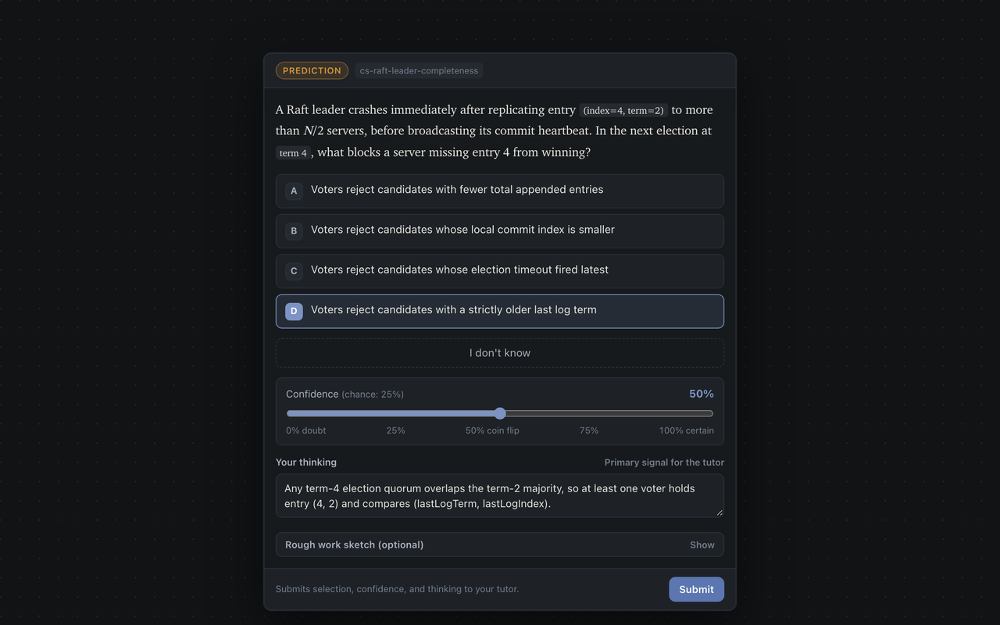
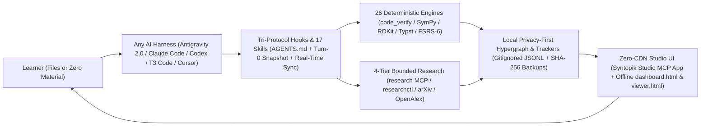

# Syntopik

**Local-first AI Deep-Mastery OS — probe your frontier, verify derivations & code deterministically, and compound FSRS-6 understanding across any AI harness.**

[](https://github.com/HridayKapoor/syntopik/actions/workflows/ci.yml)
[](./CHANGELOG.md)
[](./LICENSE)
[](#quick-start)
[](#quick-start)
[](#use-in-your-ai-harness)

Syntopik turns the AI coding harness you already use (**Google Antigravity 2.0**, **Anthropic Claude Code**, **OpenAI Codex / T3 Code**, Cursor, Windsurf, or any CLI/IDE agent) into a calm, rigorous, hands-free **Deep-Mastery Operating System** for **any domain**: Computer Science, Distributed Systems, Machine Learning, Mathematics, Physics, Chemistry, Research Papers, University Courses, and Competitive Exams (including full NTA JEE Main & Advanced CBT).

---

## Visual Showcase

Zero-CDN, calm editorial interfaces in **Warm Obsidian & Vellum Ink** (Dark) and **Archival Vellum & Graphite** (Light) — every chart, reader, and interactive card works 100% offline.

<p align="center">
  <picture>
    <source media="(prefers-color-scheme: dark)" srcset="docs/assets/dashboard-dark.png">
    <source media="(prefers-color-scheme: light)" srcset="docs/assets/dashboard-light.png">
    
  </picture>
</p>
<p align="center">
  <sub><strong>7-Tab Offline Study Hub (<code>dashboard.html</code>)</strong> — adapts automatically to your GitHub theme (<a href="docs/assets/dashboard-dark.png">Dark</a> · <a href="docs/assets/dashboard-light.png">Light</a>). Active Autopilot card, 13-category Mistake Analytics, Hypergraph, offline Markdown+LaTeX Reader, Labs, Videos &amp; Exams.</sub>
</p>

| Inline `Syntopik Studio` Quiz Card (SEP-1865 MCP App) | Joint-Premise Knowledge Hypergraph (`viewer.html`) |
| :---: | :---: |
|  |  |
| Shuffled bare options, `"I don't know"` non-penalty button, `0–100%` chance-calibrated confidence slider, thinking pad, and server-sealed `modelSolution`. | Models true multi-premise `premises[] -> conclusion` (`∧`) reasoning chains, FSRS-6/BKT mastery states, and NetworkX prerequisite bottlenecks. |

---

## Why Syntopik Beats Prompt Tutors, BYOK Wrappers & Flashcard Pipelines

| Existing Approach | Where It Breaks | How **Syntopik** Solves It |
| :--- | :--- | :--- |
| **Prompt-Only Socratic Wrappers** *(ChatGPT Study Mode, Mr. Ranedeer)* | 500-word walls of text, session amnesia, sycophantic praise, unverified math/code hallucinations. | **Calm Anti-Overstimulation Pacing** (`<= 160` words/turn, `1` active check/turn, dry zero-sycophancy voice) + **Persistent Local Hypergraph & Tracker**. |
| **Standalone BYOK Electron Tutors** *(LearnHarness, DeepTutor)* | Separate app to maintain, raw paid API bills, no CAS/code/chemistry engines, no Anki/FSRS export, no exercise ledger. | **100% Harness-Native** (zero external wrapper, uses your existing subscription) + **26 Deterministic Python/Node Engines** + **FSRS-6 / BKT / Visual Anki**. |
| **RAG + Flashcard Pipelines** *(NotebookLM → Chat → Anki)* | *"Epistemic Drift"* (AI subtly distorts caveats, encoding false memories into FSRS) + high manual export friction. | **Pre-Commit Deterministic Verification** (`math_verify.py`, `code_verify.py`, `chem_physical.py`) + **Zero-Logistics 1-Word `"Continue"` Autopilot**. |

### Six Category-Defining Capabilities
1. **Start With Files OR Zero Material (Anti-Rabbit-Hole Engine)**: Drop a folder of lecture slides, whiteboard PDFs, papers, or code — OR start cold (*"Teach me Raft Consensus from scratch"*, *"Measure-Theoretic Probability"*). A max-3-question scoping check locks a **Scope Charter** (`sources/_curated/<slug>/manifest.json`, `<= 8` primary sources with explicit out-of-scope fences) using bounded deep research (`research` MCP / `researchctl` / keyless arXiv, OpenAlex, Crossref & Wikipedia).
2. **Teacher-First Canonical Spine**: When you bring lecture/whiteboard notes alongside textbooks or problem sets, Syntopik locks your instructor's sequence (`p.1 → p.N`) as the `#1` spine and maps exercises onto it without scrambling order or colliding notations.
3. **Multi-Domain Deterministic Verification**: Every non-trivial equation, algorithm, complexity claim, unit, pH, or stereocenter is checked locally via **SymPy/Pint** (`math_verify.py`), **Sandboxed Code & Empirical Big-O Fitter** (`code_verify.py`), and **RDKit/ChemPy** (`chem_physical.py`, `chem_3d.py`, `organic_reagents.py`) *before* you ever see a problem or flashcard.
4. **Joint-Premise Knowledge Hypergraph + FSRS-6 + Mistake Analytics**: Models true multi-premise reasoning (`premises[] -> conclusion` `∧` hyperedges), ranks cross-chapter prerequisite bottlenecks via NetworkX (`graph_intel.py`), tracks 13-category Newman/Rohrer cognitive & coding traps (`mistake_analytics.py`), and schedules weighted multi-cue FSRS-6 + BKT reviews (`srs_engine.py` + `.apkg` / AnkiConnect).
5. **Two-Way SEP-1865 `Syntopik Studio` MCP App + Graceful Fallbacks**: Inline **Quiz Cards** (open `predict` / collapsed `check`, `"I don't know"`, `0–100%` confidence rail, thinking box, rough-work sketch pad), **Practice Cards** (server-sealed `modelSolution` + Pause Law), and a 5-tab Side-Pane **Study Studio** (`Autopilot`, glowing SVG `Plan`, `Graph`, zero-token `Flashcards`, `Traps`) — degrading cleanly to native question tools or calm Markdown in terminal TUIs.
6. **GitHub-Clean Privacy by Design**: All personal study state (`knowledge-graph/*.jsonl`, `chapters/*`, `exams/*`, `sources/*`) is gitignored on disk, auto-bootstrapped on fresh clones, and archivable anytime via SHA-256 verified `scripts/backup_harness.py`.

---

## System Architecture



---

## Quick Start

### Option A — Core-Only (Zero Pip Dependencies · `< 2s`)

Requires only **Python 3.12+** and **Node.js 20+**. Immediately powers CS/Algorithms/Systems (`code_verify.py`), bounded syllabus research (`research_scout.py`), Chapter Autopilot (`chapter_tracker.py`), Mistake Analytics, Offline Exams, SHA-256 Backups, Tri-Protocol Hooks, `dashboard.html`, and the `Syntopik Studio` MCP App.

```bash
git clone https://github.com/HridayKapoor/syntopik.git
cd syntopik

# Self-bootstrap gitignored learner workspace & inspect capabilities (<2 s):
python3 -B scripts/setup_harness.py auto

# Verify core stdlib + Node + multi-harness health (0 warn, 0 fail):
python3 -B scripts/study_doctor.py --core-only
```

### Option B — Full STEM Suite (`requirements-stem.txt` + `chempy --no-deps`)

Adds PDF/OCR triage (`pdf_studio.py`), SymPy/Pint CAS math & plots (`math_verify.py`, `math_plot.py`), RDKit/ChemPy chemistry (`chem_physical.py`, `chem_3d.py`, `organic_reagents.py`), Schemdraw circuits, NetworkX graph intelligence, Manim animations, neural audio briefs, and FSRS-6/Anki `.apkg` export.

```bash
git clone https://github.com/HridayKapoor/syntopik.git
cd syntopik

# 1. Create isolated Python 3.12+ environment (via uv — or standard `python3 -m venv .venv`):
uv venv --python 3.12 .venv
uv pip install -r requirements-stem.txt
uv pip install --no-deps chempy

# 2. Self-bootstrap learner workspace & inspect all capabilities (<2 s):
.venv/bin/python -B scripts/setup_harness.py auto

# 3. Verify all 45 health gates & run the 34-test sandboxed regression suite:
.venv/bin/python -B scripts/study_doctor.py
.venv/bin/python -B -m unittest discover -s tests -v
```

> **Note**: Install `chempy` with `--no-deps` (avoids pulling ~70 Jupyter packages via `pyodesys`) and never install `mendeleev` (conflicts with modern `pint`; Syntopik uses `molmass`). Optional system binaries (`typst`, `ffmpeg`, `TinyTeX`) unlock 1–2p Typst revision PDFs, narrated audio/video, and Manim LaTeX rendering.

---

## Use in Your AI Harness

| Harness | What Loads Automatically | Optional Studio / Setup Command |
| :--- | :--- | :--- |
| **Google Antigravity 2.0** | `AGENTS.md` + `GEMINI.md`, `.agents/skills/` (17 skills), `.agents/hooks.json` (`SessionStart` + `PostToolUse`), inline `<agent-embed>` widgets | `.venv/bin/python scripts/install_mcp_app.py install` *(installs `Syntopik Studio` inline cards + Side-Pane Studio)* |
| **Anthropic Claude Code** | `CLAUDE.md` (imports `@AGENTS.md`), `.claude/skills/` (17 skills), `.claude/settings.json` hooks, `.mcp.json` (`syntopik-studio` stdio MCP) | Works out of the box on `claude` CLI & Claude Desktop! |
| **OpenAI Codex / T3 Code** | `AGENTS.md`, `.agents/skills/` (17 native skills), `.codex/config.toml` (`syntopik-studio` MCP + multi-agent), `.codex/hooks.json` | Works out of the box (including isolated T3 Code Git worktrees via auto-bootstrap & `SYNT_KG_DIR`)! |
| **Cursor / Windsurf / Cline / Zed / Any Agent** | `AGENTS.md` + [`BOOTSTRAP.md`](./BOOTSTRAP.md) | Tell the agent: `Read BOOTSTRAP.md and run python3 scripts/setup_harness.py auto` |

---

## Start Learning in Two Prompts (Any Topic, With or Without Files)

### 1A. Start Cold on *Any* Topic (Zero Files Needed!)
> `Teach me Distributed Consensus & Raft from scratch for systems interviews.`
> *(Syntopik asks at most 3 quick scoping questions, curates up to 8 bounded primary sources via `research_scout.py`, initializes `chapters/raft-tracker.json`, and probes your frontier immediately.)*

### 1B. Start From Your Own Course Slides, Papers, Repo, or JEE Folder
> `Start Simple Harmonic Motion from @sources/shm/ — use my lecture notes as the primary spine.`

### 2. Resume Any Day With One Word
> `Continue`

### More Power Workflows
- **CS / Algorithms / ML Practice (Verified via `code_verify.py`)**: `Drill me on Dynamic Programming vs Greedy discrimination problems — verify time complexity and edge cases with code_verify.py.`
- **Handwritten Proof / Rough-Paper Photo Grader**: *(Drag a photo into chat)* `Check my handwritten derivation — find the earliest broken line and give me only an R0–R2 nudge.`
- **Offline Study Hub & Printable 1–2p Typst Sheets**: `node scripts/sync-graph.mjs --open` · `Compile a 2-column Mastery & Pitfall PDF for chapters/<slug>.md via cheatsheet_pdf.py.`

---

## Component Inventory (17 Skills · 26 Scripts · Tri-Protocol Hooks · Calm Editorial UI)

- **17 Progressive-Disclosure Skills (`.agents/skills/` & `.claude/skills/`)**:
  `topic-onboarding` · `chapter-autopilot` · `teach-chapter` · `practice-drill` · `grade-handwriting` · `exam-simulator` · `universal-pdf-study` · `ingest-chapter` · `visual-and-demo` · `revision-sheets` · `knowledge-graph` · `physics-circuits-and-units` · `physical-chemistry` · `organic-chemistry-tutor` · `manim-animator` · `subagent-orchestrator` · `harness-self-improve`.
- **26 Local Deterministic Engines (`scripts/`)**:
  - *Bootstrap, Research & Autopilot*: `setup_harness.py`, `research_scout.py`, `chapter_tracker.py`, `graph_intel.py`, `daily_plan.py`, `audio_brief.py`, `backup_harness.py`, `study_doctor.py`, `sync-graph.mjs`, `install_mcp_app.py`.
  - *CS, Math, Physics & Chemistry Verifiers*: `code_verify.py`, `math_verify.py`, `math_plot.py`, `physics_draw.py`, `circuit_draw.py`, `chem_physical.py`, `chem_3d.py`, `organic_reagents.py`, `eduniti_pyq.py`.
  - *PDFs, Typst Sheets, Manim Video, Memory & Timed Exams*: `pdf_studio.py`, `cheatsheet_pdf.py`, `manim_helpers.py`, `narrate_video.py`, `srs_engine.py`, `mistake_analytics.py`, `exam_runner.py`.
- **Calm Editorial Offline Apps**:
  - `dashboard.html` (7-tab Study Hub with Active Autopilot Card, Mistake Analytics, Hypergraph, offline Markdown+LaTeX Chapter Reader Drawer, Labs, Videos, Exams; keys `/`, `1–7`, `t`, `Esc`, `?`), `knowledge-graph/viewer.html`, `demos/exam-cbt-template.html`, and `mcp-app/mlh-studio/`.

---

## Documentation, Security & License

- [`BOOTSTRAP.md`](./BOOTSTRAP.md) — Universal self-configuring agent bootstrap & 4-axis UX capability matrix.
- [`SELF_IMPROVEMENT_BLUEPRINT.md`](./SELF_IMPROVEMENT_BLUEPRINT.md) — Complete engineering spec, regression watchlist & self-improvement loop.
- [`CONTRIBUTING.md`](./CONTRIBUTING.md) — Architecture invariants, token-budget ceilings & verification gates.
- [`SECURITY.md`](./SECURITY.md) — Privacy model, sandbox boundaries & responsible vulnerability reporting.
- [`CHANGELOG.md`](./CHANGELOG.md) — Release history (`v1.0.0`).
- Licensed under the [MIT License](./LICENSE).
